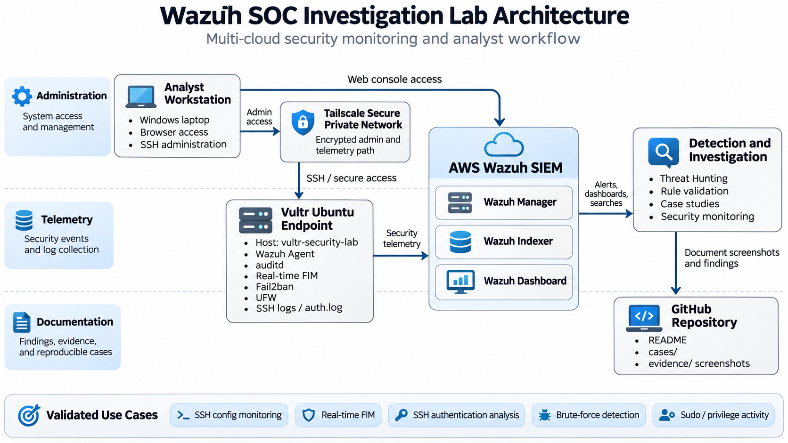

# Wazuh SOC Investigation Lab

Multi-cloud cybersecurity lab built to practice SOC monitoring, detection engineering, Linux security, and incident investigation using Wazuh.

## Architecture

The lab uses a Vultr Ubuntu endpoint monitored by a Wazuh agent and an AWS-hosted Wazuh SIEM. Tailscale provides private connectivity for administrative access and security telemetry.

## Environment

- AWS EC2 Wazuh SIEM
- Vultr Ubuntu security endpoint
- Wazuh 4.14.8
- Linux auditd
- Real-time File Integrity Monitoring
- UFW
- Fail2ban
- Tailscale private networking

## Detection and Investigation Cases

### Case 001 — SSH Configuration Change Detection

Built and validated a custom auditd-based Wazuh detection for changes to SSH configuration files.

Evidence includes Rule 100100 alerts and SSH configuration change telemetry.

### Case 002 — Real-Time File Integrity Monitoring

Validated real-time detection of file creation, modification, and deletion on the Vultr Linux endpoint.

Detected:

- Rule 554 — File added to the system
- Rule 550 — Integrity checksum changed
- Rule 553 — File deleted

[View Case 002](cases/case-002-real-time-file-integrity-monitoring.md)

### Case 003 — SSH Authentication and Internet Scanning Investigation

Investigated repeated SSH authentication attempts against the Vultr endpoint and distinguished suspicious Internet scanning from authorized administrative access.

Observed:

- Rule 5710 — Attempt to login using a non-existent user
- Rule 5712 — SSH brute-force correlation
- Rule 5715 — Successful SSH authentication
- Fail2ban automated blocking

[View Case 003](cases/case-003-ssh-authentication-and-internet-scanning.md)

### Case 004 — Sudo and Privilege Activity Investigation

Validated detection of privileged Linux activity using Wazuh.

Observed:

- Rule 5402 — Successful sudo to ROOT executed
- Rule 5501 — PAM login session opened
- Rule 5502 — PAM login session closed

[View Case 004](cases/case-004-sudo-privilege-activity.md)

## Skills Demonstrated

- SIEM deployment and administration
- Linux security monitoring
- Wazuh Threat Hunting
- auditd telemetry
- File Integrity Monitoring
- SSH authentication analysis
- Brute-force detection and correlation
- Fail2ban enforcement
- sudo and root privilege monitoring
- Custom Wazuh detection engineering
- Multi-cloud networking with Tailscale
- Security event investigation and documentation

## Project Outcome

The core multi-cloud SOC lab is operational and the primary detection-validation scenarios are complete.

The project demonstrates a complete workflow from Linux endpoint activity to centralized SIEM detection, analyst investigation, and documented case studies.

## Disclaimer

This repository documents a controlled cybersecurity lab environment. Test activity was intentionally generated for learning and detection-validation purposes.