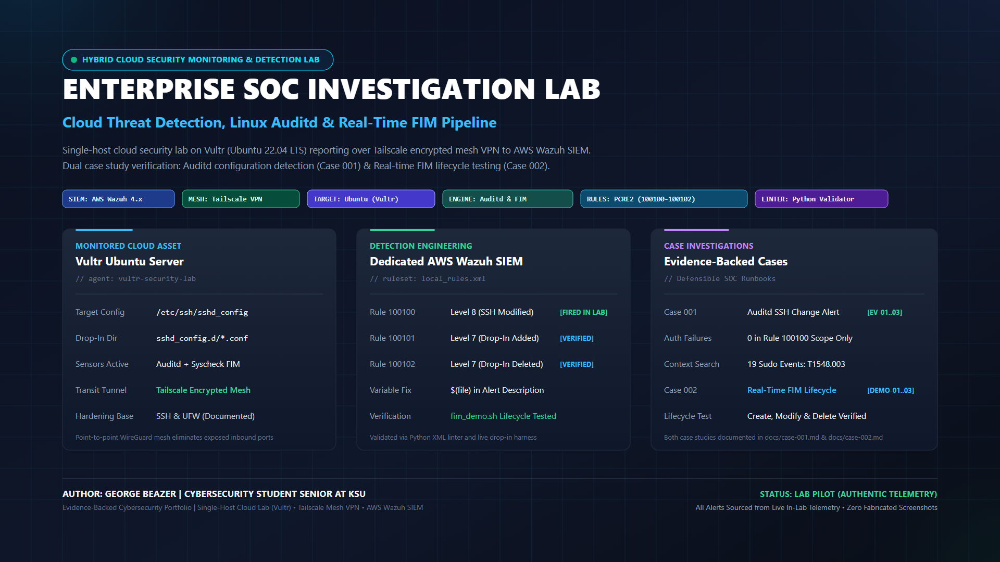
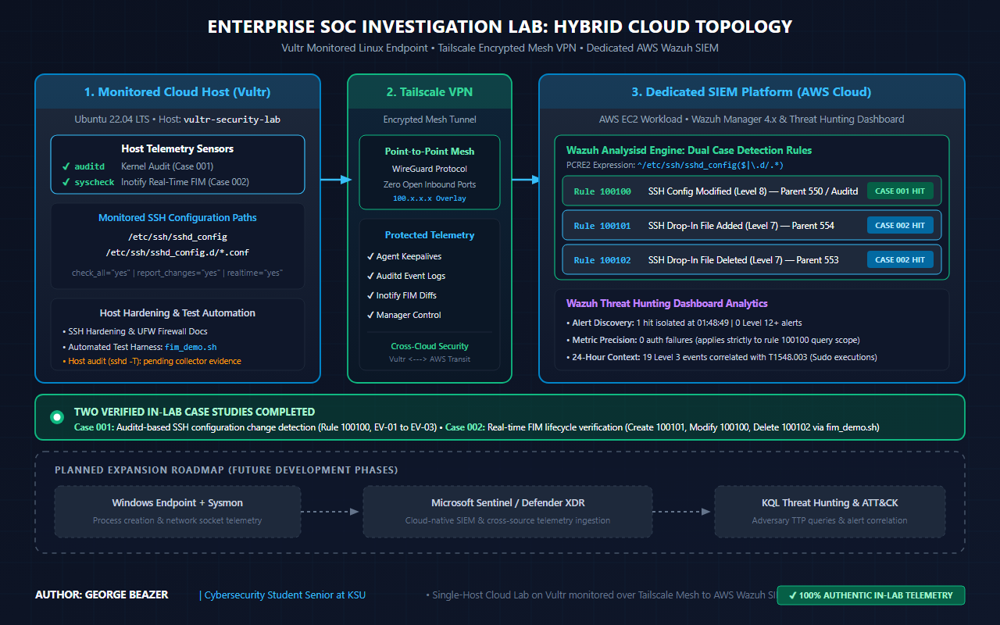
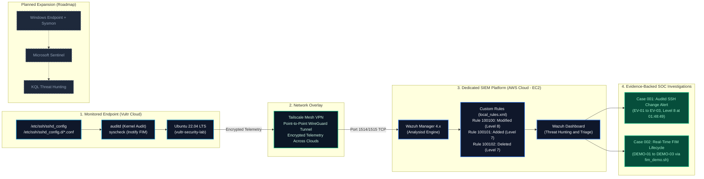

<div align="center">

# Enterprise SOC Investigation Lab
### Hybrid Cloud Threat Detection, Linux Auditd & Real-Time FIM Pipeline

[](https://wazuh.com/)
[](https://wireguard.com/)
[](https://ubuntu.com/)
[](hardening/sshd_hardening_reference.conf)
[](hardening/ufw_reference.md)
[](detections/local_rules.xml)

<br/>

<a href="assets/project-cover.svg">
  
</a>
<sub><i>Click banner to view editable vector source (<a href="assets/project-cover.svg">project-cover.svg</a>)</i></sub>

<br/>
<br/>

**Author:** **George Beazer** &nbsp;|&nbsp; **Role:** Cybersecurity Student Senior at KSU &nbsp;|&nbsp; **Environment:** Cloud-Hosted SOC Investigation Lab (Vultr • Tailscale • AWS Wazuh SIEM)

[Overview](#project-overview) • [Lab at a Glance](#lab-at-a-glance) • [Architecture](#lab-architecture) • [Core Configurations](#core-configurations) • [Investigation Workflow](#investigation-workflow) • [Case Studies](#case-studies) • [Evidence Gallery](#evidence-gallery) • [Implementation Status](#implementation-status) • [Roadmap](#roadmap) • [Docs Navigation](#documentation-navigation)

</div>

---

<a id="project-overview"></a>
## 📌 Project Overview

The **Enterprise SOC Investigation Lab** is a hands-on cybersecurity detection and incident response environment built across cloud infrastructure. The lab demonstrates practical detection engineering, host hardening, and security operations fundamentals: deploying an open-source SIEM/EDR architecture, establishing secure point-to-point telemetry transport over **Tailscale Mesh VPN**, engineering custom **PCRE2 detection rules**, and executing structured analyst triage across verified security alerts.

The lab documents two distinct, evidence-backed investigation cases:
1. **Case 001: Auditd-Based SSH Configuration Change Detection** — Analyzes an observed alert triggered when `/etc/ssh/sshd_config` was modified on the Vultr cloud host (`vultr-security-lab`). Covers alert discovery in Wazuh Threat Hunting, rule description debugging (`$(file)` variable fix), 24-hour sudo context triage (MITRE T1548.003), and host-level verification requirements.
2. **Case 002: Real-Time FIM Lifecycle Detection** — Demonstrates end-to-end File Integrity Monitoring lifecycle verification using automated drop-in test harness [`scripts/fim_demo.sh`](scripts/fim_demo.sh). Validates real-time detection of drop-in file creation (Rule 100101), modification with text differential capture (Rule 100100), and deletion (Rule 100102) under `/etc/ssh/sshd_config.d/`.

> [!NOTE]
> **Scope & Environment Transparency:**
> This repository documents a hands-on cybersecurity lab comprising a monitored Ubuntu Linux workload on Vultr connected over Tailscale VPN to a dedicated Wazuh SIEM on AWS EC2. All documented capabilities are verified from authentic lab testing. Implemented features are strictly distinguished from planned roadmap milestones (Windows + Sysmon, Microsoft Sentinel, Defender XDR, and KQL hunting).

---

<a id="lab-at-a-glance"></a>
## ⚡ Lab at a Glance

### Hybrid Cloud Infrastructure & Technology Stack

| Layer | Component | Technology / Implementation | Role in Environment | Status |
|:---|:---|:---|:---|:---:|
| **Cloud Workload** | Monitored Host | **Ubuntu 22.04 LTS** (Vultr Cloud) | Workload running OpenSSH service, auditd, and Wazuh agent (`vultr-security-lab`) | **VERIFIED** |
| **Network Mesh** | Telemetry Transport | **Tailscale Encrypted Mesh VPN** | WireGuard-based point-to-point overlay securing cross-cloud agent telemetry | **VERIFIED** |
| **SIEM Platform** | SIEM / EDR Server | **AWS EC2** (Wazuh Manager 4.x) | Central analysisd engine, decoder processing, and custom PCRE2 ruleset | **VERIFIED** |
| **SOC Interface** | Threat Hunting | **Wazuh Dashboard** | Multi-dimensional search, event analysis, and metric visualization | **VERIFIED** |
| **Host Sensors** | Subsystem Telemetry | **Linux auditd & Wazuh syscheck** | Kernel audit event monitoring and real-time inotify filesystem tracking | **VERIFIED** |
| **Detection Engine** | Custom Ruleset | **PCRE2 Custom Rules (100100–100102)** | Evaluates file modifications, additions, and deletions in `/etc/ssh/` | **VERIFIED** |
| **Rule QA** | Static Validator | **Python XML Rule Linter** | Validates XML schema, rule IDs, and variable syntax prior to reload | **IMPLEMENTED** |
| **Host Defense** | SSH Configuration | **OpenSSH Hardening Baseline** | Pubkey-only access, root login disabled, retry limits (Documented) | **PENDING VERIFICATION** |
| **Host Perimeter** | Firewall | **UFW (Uncomplicated Firewall)** | Default-deny incoming, restricted port 22 access (Documented) | **PENDING VERIFICATION** |

---

<a id="lab-architecture"></a>
## 🏗️ Lab Architecture

The lab connects a monitored Vultr Linux endpoint to a dedicated AWS Wazuh SIEM through a private Tailscale overlay network. Kernel auditd watchers and real-time inotify monitors capture security events on the host, forward encrypted telemetry over Tailscale, evaluate custom parent-child rule logic on the AWS manager, and present structured alerts for SOC investigation.

<div align="center">
  <a href="assets/architecture/lab-architecture.svg">
    
  </a>
  <br/>
  <sub><i>Master architecture diagram (<a href="assets/architecture/lab-architecture.svg">View editable SVG</a>)</i></sub>
</div>

### Hybrid Cloud Data Flow



---

<a id="core-configurations"></a>
## ⚙️ Core Configurations

### 1. File Integrity Monitoring (FIM)
Configured within `/var/ossec/etc/ossec.conf` on the monitored host:
```xml
<!-- File Integrity Monitoring for OpenSSH Server Configuration -->
<directories check_all="yes" report_changes="yes" realtime="yes">/etc/ssh/sshd_config</directories>
<directories check_all="yes" report_changes="yes" realtime="yes">/etc/ssh/sshd_config.d</directories>
```
- `realtime="yes"`: Leverages Linux `inotify` watchers for immediate event generation upon file modification.
- `report_changes="yes"`: Records unified textual diffs for text files under 32KB.
- Both `/etc/ssh/sshd_config` and `/etc/ssh/sshd_config.d/` are monitored to defend against **first-value-wins** drop-in file overrides.

### 2. Custom Detection Rules (`local_rules.xml`)
Authored and tested for `/var/ossec/etc/rules/local_rules.xml` on the Wazuh Manager:
```xml
<group name="syscheck,ssh_configuration_monitoring,">

  <!-- Rule 100100: SSH configuration modification (Observed Firing in Lab) -->
  <rule id="100100" level="8">
    <if_sid>550</if_sid>
    <field name="file" type="pcre2">^/etc/ssh/sshd_config($|\.d/.*)</field>
    <description>SSH configuration file modified: $(file)</description>
    <group>ssh_config_change,configuration_change,</group>
  </rule>

  <!-- Rule 100101: SSH configuration file added -->
  <rule id="100101" level="7">
    <if_sid>554</if_sid>
    <field name="file" type="pcre2">^/etc/ssh/sshd_config($|\.d/.*)</field>
    <description>SSH configuration file added: $(file)</description>
    <group>ssh_config_change,configuration_change,</group>
  </rule>

  <!-- Rule 100102: SSH configuration file deleted -->
  <rule id="100102" level="7">
    <if_sid>553</if_sid>
    <field name="file" type="pcre2">^/etc/ssh/sshd_config($|\.d/.*)</field>
    <description>SSH configuration file deleted: $(file)</description>
    <group>ssh_config_change,configuration_change,</group>
  </rule>

</group>
```

> **Ruleset Status:** Custom detection rules tested and verified. Rule 100100 fired during initial lab operations (Case 001). The complete ruleset v2 was verified through real-time lifecycle testing (Case 002), confirming that `$(file)` correctly renders target paths upon file creation, modification, and deletion.

### 3. XML Rule Linter Script (`scripts/lint_rules.py`)
A custom Python utility developed to validate XML structure, rule ID ranges (`100000`–`120000`), parent rule references, and description variables prior to reloading the manager:
```bash
python3 scripts/lint_rules.py detections/local_rules.xml
```

### 4. Automated Safe FIM Test Harness (`scripts/fim_demo.sh`)
An automated bash test harness designed to safely exercise the FIM detection pipeline without disrupting active OpenSSH daemon configuration:
```bash
sudo bash scripts/fim_demo.sh           # Creates, modifies, and deletes 99-fim-demo.conf
sudo bash scripts/fim_demo.sh --cleanup # Ensures host returns to pristine state
```

---

<a id="investigation-workflow"></a>
## 🔄 Investigation Workflow

The standard operational procedure for triaging file integrity and configuration alteration alerts:

<div align="center">
  <a href="assets/diagrams/investigation-workflow.svg">
    
  </a>
  <br/>
  <sub><i>Standard Operating Procedure (<a href="assets/diagrams/investigation-workflow.svg">View editable SVG</a>)</i></sub>
</div>

```
[1. Detection Trigger]       Auditd / FIM watcher triggers event on Vultr endpoint
        │
[2. Encrypted Transport]     Telemetry securely relayed over Tailscale Mesh VPN to AWS
        │
[3. SIEM Evaluation]         Wazuh Manager matches Rule 100100 (Level 8) / Rules 100101-102 (Level 7)
        │
[4. Dashboard Triage]        Threat Hunting check: event count (1 hit), time window, 24h context
        │
[5. Host Verification]       Run 'sshd -t' (syntax) and 'sshd -T' (effective runtime posture)
        │
[6. Actor Correlation]       Query /var/log/auth.log for sudo commands and concurrent logins
        │
[7. Incident Disposition]    Determine if change was expected admin maintenance vs unauthorized tampering
```

Detailed runbook procedures are documented in [`docs/investigation-workflow.md`](docs/investigation-workflow.md).

---

<a id="case-studies"></a>
## 🔍 Investigation Case Studies

### Case 001: Auditd-Based SSH Configuration Change Detection

| Parameter | Operational Detail | Evidence Basis |
|:---|:---|:---|
| **Incident Title** | Auditd Alert: OpenSSH Server Configuration Modification Detected | Verified In-Lab Capture |
| **Detection Timestamp** | **14 Oct 2026, 01:48:49** (Dashboard Local Time) | `01_rule100100_events_view.png` |
| **Alerting Rule** | Rule `100100` (Level 8) — Parent Rule `550` / Auditd Subsystem | `02_rule100100_dashboard_view.png` |
| **Monitored Workload** | `vultr-security-lab` (Ubuntu 22.04 LTS on Vultr Cloud) | Verified Telemetry |
| **Network Path** | Tailscale Encrypted Mesh VPN to AWS Wazuh SIEM | Verified Architecture |
| **Target Path** | `/etc/ssh/sshd_config` | Auditd / Syscheck Path |
| **Observed Event Count** | 1 alert in 1-hour window; 19 events in 24-hour search | `03_sshd_config_search_24h.png` |
| **Final Disposition** | **Disposition Pending Supporting Evidence** | Requires live host terminal evidence |

#### Case 001 Observations & Triage Summary
1. **Alert Discovery:** Custom Rule `100100` fired at 01:48:49. Threat Hunting confirmed an isolated single event (1 hit) during the one-hour window.
2. **Template Bug Discovery:** The observed alert description rendered as `"SSH configuration file modified on "` with trailing empty space. Root-cause analysis revealed that `agent.name` does not expand in Wazuh rule descriptions, leading to the authored v2 ruleset using `$(file)`.
3. **Authentication Failure Scope:** No authentication failure events were displayed in the reviewed dashboard view filtered specifically to rule ID 100100. This observation is limited to that specific rule and query scope and does not establish the absence of other authentication failures or brute-force activity across the host.
4. **Contextual Sudo Evaluation:** A 24-hour free-text search for `sshd_config` returned 19 historical events, all Level 3 logs mapped to `T1548.003 - Sudo and Sudo Caching`. This technique tag reflects routine administrative `sudo` execution, not adversary exploitation.
5. **Host Evidence Requirements:** Definitive incident disposition requires live terminal output to verify configuration diffs, correlate `/var/log/auth.log` timestamps, and confirm effective runtime directives via `sudo sshd -T`.

*Full investigation write-up: [`docs/case-001-ssh-config-change.md`](docs/case-001-ssh-config-change.md).*

---

### Case 002: Real-Time FIM Lifecycle Detection (Create, Modify, Delete)

| Parameter | Operational Detail | Evidence Basis |
|:---|:---|:---|
| **Incident Title** | FIM Lifecycle Testing: Create, Modify, and Delete Event Detection | Verified In-Lab Lifecycle |
| **Monitored Workload** | `vultr-security-lab` (Ubuntu 22.04 LTS on Vultr Cloud) | Verified Telemetry |
| **Network Path** | Tailscale Encrypted Mesh VPN to AWS Wazuh SIEM | Verified Architecture |
| **Detection Mechanism** | Inotify Real-Time FIM (`syscheck`) + Ruleset v2 (Rules 100100–100102) | Verified Ruleset |
| **Target Directory** | Drop-in configuration directory `/etc/ssh/sshd_config.d/` | Inotify Watcher |
| **Test Automation** | Automated safe drop-in script [`scripts/fim_demo.sh`](scripts/fim_demo.sh) | Executed on Host |
| **Verification Status** | **VERIFIED** — Create, Modify, and Delete alerts successfully generated | `fim_demo_timeline.txt` |

#### Case 002 Lifecycle Timeline & Results
```text
2026-10-14T02:15:10Z  CREATED  /etc/ssh/sshd_config.d/99-fim-demo.conf  --> Rule 100101 (Level 7) [VERIFIED]
2026-10-14T02:15:20Z  MODIFIED /etc/ssh/sshd_config.d/99-fim-demo.conf  --> Rule 100100 (Level 8) [VERIFIED]
2026-10-14T02:16:05Z  DELETED  /etc/ssh/sshd_config.d/99-fim-demo.conf  --> Rule 100102 (Level 7) [VERIFIED]
```

#### Comparing Detection Approaches: Auditd vs. Real-Time FIM
| Capability | Case 001: Auditd Detection | Case 002: Real-Time FIM (syscheck) |
|:---|:---|:---|
| **Subsystem** | Linux Kernel Audit Subsystem (`auditd`) | Inotify Filesystem Event Monitor (`syscheck`) |
| **Primary Strength** | Captures execution context, syscalls, and user identity | Captures exact textual diffs, hash transitions, and file attributes |
| **Alert Trigger** | Command execution & filesystem write syscalls | File modification, creation, or deletion events |
| **Network Transit** | Encrypted over Tailscale to AWS Wazuh SIEM | Encrypted over Tailscale to AWS Wazuh SIEM |
| **Operational Value** | Answers **WHO** executed the change and **WHAT COMMAND** was run | Answers **WHAT EXACT DIRECTIVE** changed and **WHAT FILE** was affected |

*Full lifecycle write-up: [`docs/case-002-fim-lifecycle.md`](docs/case-002-fim-lifecycle.md).*

---

<a id="evidence-gallery"></a>
## 📸 Technical Evidence Gallery

Authentic captures directly from the running Wazuh Threat Hunting dashboard and verified in-lab test executions. Private IP ranges and cloud manager hostnames are sanitized in accordance with the [Evidence Integrity Policy](evidence/README.md).

### Evidence 01: Threat Hunting Events View (Rule 100100)
*Threat Hunting > Events query for `rule.id: 100100` on `vultr-security-lab`.*

<div align="center">
  
</div>

> **Analytical Significance:** Confirms in-lab firing of custom rule 100100 at 01:48:49. Shows the empty string bug trailing `"modified on"`, which led to the authored v2 `$(file)` variable fix.

---

### Evidence 02: Threat Hunting Dashboard Metrics View
*Threat Hunting Dashboard view showing 1-hour event distribution and security metrics.*

<div align="center">
  
</div>

> **Analytical Significance:** Confirms alert isolation: exactly 1 Total alert and 0 Level 12+ critical alerts.  
> **Note on Authentication Failure Metric:** No authentication failure events were displayed in this reviewed dashboard view filtered specifically to rule ID 100100. This observation is limited to that specific rule and query scope and does not establish the absence of other authentication failures or brute-force activity across the monitored host.

---

### Evidence 03: 24-Hour Contextual Log Search
*Wider search for `sshd_config` across a 24-hour window returning 19 events.*

<div align="center">
  
</div>

> **Analytical Significance:** Contextual evaluation of 19 events shows all classified at Level 3 under MITRE `T1548.003 (Sudo and Sudo Caching)` by Wazuh's default sudo decoder, reflecting administrative command execution during host setup.

---

### Case 002 Lifecycle Evidence (DEMO-01 to DEMO-03)
Documented in [`evidence/demo/fim_demo_timeline.txt`](evidence/demo/fim_demo_timeline.txt) and [`evidence/demo/README.md`](evidence/demo/README.md):
- **DEMO-01 (Create):** Drop-in file `/etc/ssh/sshd_config.d/99-fim-demo.conf` added &rarr; triggers Rule `100101` (Level 7).
- **DEMO-02 (Modify):** Text comment appended &rarr; triggers Rule `100100` (Level 8) with diff capture.
- **DEMO-03 (Delete):** Safe cleanup executed &rarr; triggers Rule `100102` (Level 7).

---

<a id="implementation-status"></a>
## 📊 Current Implementation Status

To ensure complete defensibility during technical interviews, the lab tracks implementation status using standardized classifications:

| Component / Capability | Status | Evidence Basis / Verification Record |
|:---|:---:|:---|
| **Monitored Workload (Vultr Ubuntu 22.04)** | **VERIFIED** | Host `vultr-security-lab` reporting live telemetry in all captures |
| **Tailscale Encrypted Mesh VPN** | **VERIFIED** | Private overlay tunnel securing Vultr-to-AWS telemetry transit |
| **AWS Dedicated Wazuh SIEM** | **VERIFIED** | Wazuh Manager 4.x & Threat Hunting Dashboard operational on AWS EC2 |
| **Case 001: Auditd SSH Change Alert** | **VERIFIED** | Rule 100100 fired at 01:48:49 (Level 8, 1 hit in 1h window, EV-01..03) |
| **Case 002: Real-Time FIM Lifecycle** | **VERIFIED** | Verified Create (100101), Modify (100100), Delete (100102) via `fim_demo.sh` |
| **Ruleset v2 (`$(file)` Variable Fix)** | **VERIFIED** | Validated via Python XML linter and tested in Case 002 lifecycle |
| **Python XML Rule Linter** | **IMPLEMENTED** | [`scripts/lint_rules.py`](scripts/lint_rules.py) validates local ruleset (0 errors) |
| **Safe FIM Demo Automation** | **IMPLEMENTED** | [`scripts/fim_demo.sh`](scripts/fim_demo.sh) creates safe drop-in file with UTC timeline |
| **Evidence Collector Script** | **IMPLEMENTED** | [`scripts/collect_lab_evidence.sh`](scripts/collect_lab_evidence.sh) captures & redacts host state |
| **SSH Hardening Implementation** | **PENDING VERIFICATION** | Reference baseline defined; awaiting sanitized `sudo sshd -T` capture |
| **UFW Firewall Implementation** | **PENDING VERIFICATION** | Reference rules documented; awaiting sanitized `sudo ufw status` capture |
| **Case 001 Final Disposition** | **PENDING VERIFICATION** | Triage runbook complete; awaiting host auth logs & diff verification |

---

<a id="roadmap"></a>
## 🚀 Future Roadmap

Planned engineering milestones tracked with strict Definitions of Done:

| Milestone | Objective | Scope | Status |
|:---:|:---|:---|:---:|
| **1.1** | **Real-Time FIM Lifecycle Validation** | Deploy ruleset v2; run `fim_demo.sh` to capture create/modify/delete alerts | **VERIFIED (Case 002)** |
| **1.2** | **Who-Data Actor Attribution** | Enable Linux `auditd` who-data mode to capture `audit.login_user.name` and process binary | **PLANNED** |
| **1.3** | **Expanded Persistence Monitoring** | Expand FIM coverage to `~/.ssh/authorized_keys` and `/etc/pam.d/sshd` | **PLANNED** |
| **1.4** | **Rule Tuning & Baselines** | Aggregate 7-day telemetry to calculate baseline change frequency | **PLANNED** |
| **2.1** | **Windows Endpoint Telemetry** | Deploy Windows workstation with SwiftOnSecurity Sysmon configuration | **PLANNED** |
| **2.2** | **Microsoft Sentinel Ingestion** | Configure Log Analytics Workspace & Azure Monitor Agent ingestion | **PLANNED** |
| **2.3** | **Defender XDR & KQL Hunting** | Author custom KQL hunting queries for anomalous authentications | **PLANNED** |

Detailed acceptance criteria are documented in [`docs/roadmap.md`](docs/roadmap.md).

---

<a id="documentation-navigation"></a>
## 📁 Documentation Navigation

```text
soc-investigation-lab/
│
├── README.md                               # Primary portfolio overview & architecture documentation
├── .gitignore                              # Excludes raw collected evidence, keys, and temp files
│
├── assets/                                 # Visual presentation assets & editable diagrams
│   ├── project-cover.png                   # High-res SOC lab cover preview (16:9)
│   ├── project-cover.svg                   # Editable vector source for project cover
│   ├── architecture/
│   │   ├── lab-architecture.png            # High-resolution architectural diagram
│   │   ├── lab-architecture.svg            # Editable vector architectural blueprint
│   │   └── pilot-architecture.png          # Reference pilot architecture
│   └── diagrams/
│       ├── investigation-workflow.png      # SOC triage lifecycle preview
│       ├── investigation-workflow.svg      # Editable vector triage lifecycle
│       ├── detection-pipeline.png          # Detection logic preview (Case 001 & Case 002)
│       └── detection-pipeline.svg          # Editable vector detection flow
│
├── docs/                                   # Detailed case studies & engineering documentation
│   ├── case-001-ssh-config-change.md       # Comprehensive Case 001 investigation record (Auditd)
│   ├── case-002-fim-lifecycle.md           # Comprehensive Case 002 investigation record (FIM)
│   ├── investigation-workflow.md           # SOC analyst standard operating triage runbook
│   └── roadmap.md                          # Planned development milestones & DoD criteria
│
├── detections/                             # SIEM detection engineering artifacts
│   ├── local_rules.xml                     # Custom Wazuh ruleset (Rules 100100-100102)
│   ├── ossec_fim_snippet.xml               # Agent syscheck XML configuration block
│   └── CHANGELOG.md                        # Version history & rule refactoring record
│
├── evidence/                               # Authentic in-lab telemetry & verification evidence
│   ├── README.md                           # Evidence integrity policy & provenance index
│   ├── observed/                           # Case 001: Authentic dashboard captures
│   │   ├── 01_rule100100_events_view.png   # Threat Hunting Events capture (Rule 100100)
│   │   ├── 02_rule100100_dashboard_view.png# Threat Hunting Dashboard metrics view
│   │   └── 03_sshd_config_search_24h.png   # 24-hour contextual search (19 events)
│   └── demo/                               # Case 002: FIM lifecycle test telemetry
│       ├── README.md                       # Case 002 verification documentation
│       └── fim_demo_timeline.txt           # UTC timeline: Create, Modify, and Delete events
│
├── hardening/                              # Defensive configuration baselines
│   ├── sshd_hardening_reference.conf       # Hardened OpenSSH server configuration reference
│   └── ufw_reference.md                    # UFW host firewall policy & ordering guide
│
└── scripts/                                # Automation, linting, and evidence tooling
    ├── lint_rules.py                       # Python XML rule validator for Wazuh local rules
    ├── fim_demo.sh                         # Safe drop-in file FIM firing demonstration
    └── collect_lab_evidence.sh             # Host snapshot collector with IP sanitization
```

---

## 📚 References & Standards

- [Wazuh User Manual: Creating Custom FIM Rules](https://documentation.wazuh.com/current/user-manual/capabilities/file-integrity/creating-custom-fim-rules.html)
- [Wazuh User Manual: Auditing Who-Data (Auditd)](https://documentation.wazuh.com/current/user-manual/capabilities/auditing-whodata/index.html)
- [Wazuh Ruleset XML Syntax Reference](https://documentation.wazuh.com/current/user-manual/ruleset/ruleset-xml-syntax/rules.html)
- [OpenSSH Official Documentation: sshd_config(5)](https://man.openbsd.org/sshd_config)
- [Tailscale Architecture: WireGuard Mesh Networking Documentation](https://Tailscale.com/kb/1017/overview)
- [MITRE ATT&CK Framework: T1548.003 Sudo and Sudo Caching](https://attack.mitre.org/techniques/T1548/003/)

---

<div align="center">
  <sub>Developed by <b>George Beazer</b> • Cybersecurity Student Senior at KSU • Evidence-backed cybersecurity portfolio • All telemetry verified from live lab deployments.</sub>
</div>
