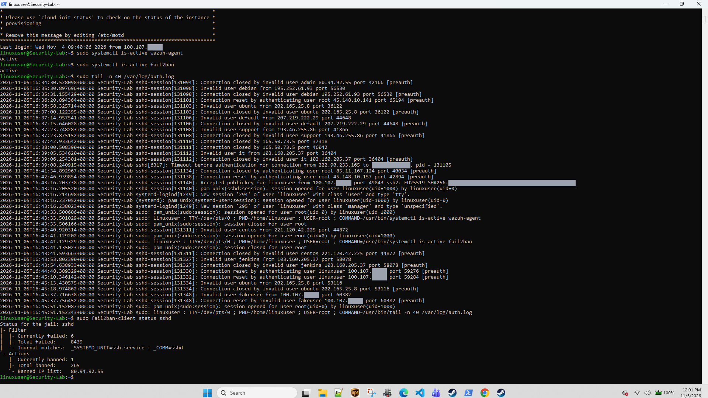
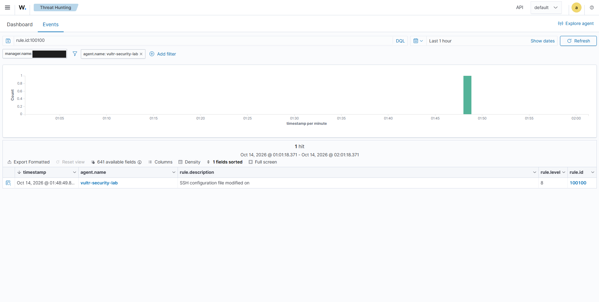
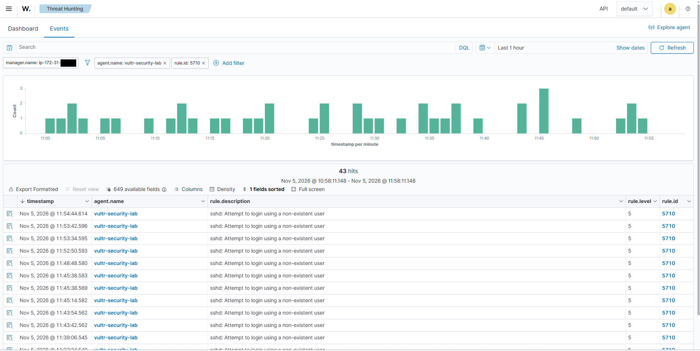
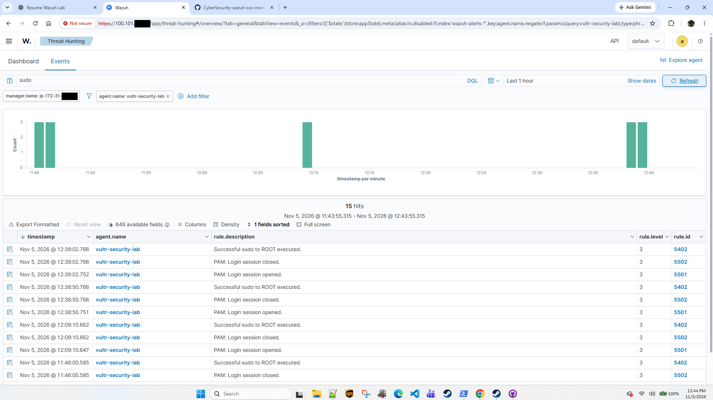
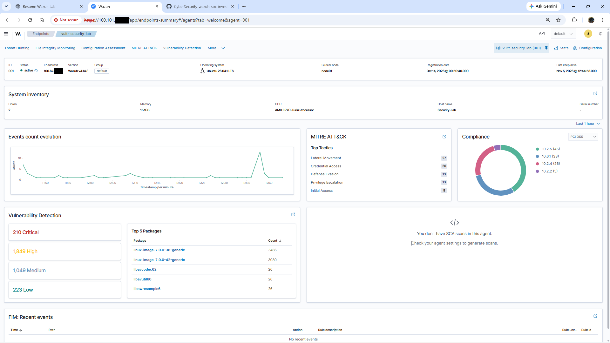

<div align="center">

# Enterprise SOC Investigation Lab
### Wazuh detection engineering and SSH investigations on a cloud Linux host

[](https://wazuh.com/)
[](architecture/README.md)
[](evidence/README.md)
[](hardening/sshd_hardening_reference.conf)
[](docs/case-003-ssh-authentication-attacks.md)
[](detections/local_rules.xml)

<br/>

<a href="assets/project-cover.svg"></a>

<br/>

**George Beazer** · Cybersecurity student, senior at KSU · Student homelab: one monitored endpoint, one Wazuh manager. Not a production SOC.

[At a glance](#at-a-glance) • [Architecture](#architecture) • [Cases](#investigation-cases) • [Rules](#custom-detection-rules) • [Evidence](#evidence) • [Lessons](#what-i-got-wrong-and-fixed) • [Status](#status)

</div>

---

<a id="at-a-glance"></a>
## 🛡️ At a glance

**What I built.** An Ubuntu 26.04 server on **Vultr** runs the **Wazuh agent (v4.14.8)** and reports to a **Wazuh manager on AWS EC2**. I reach both over a **Tailscale** overlay. The server's SSH port is open to the internet, so it attracts real scanning. I wrote **custom Wazuh FIM rules** for OpenSSH configuration changes and investigated what the SIEM captured.

**What I investigated.**

| Case | What happened | Status |
|:---|:---|:---|
| [001](docs/case-001-ssh-config-change.md) | My custom Rule 100100 fired at Level 8 with an SSH configuration warning. The exact changed file and the v1 parent rule are not visible in the capture. Its blank description exposed a template bug I corrected in the newer rule. | Alert observed · disposition **pending** |
| [002](docs/case-002-fim-lifecycle.md) | Safe create/modify/delete test in the SSH drop-in directory | Test recorded · alerts **not captured**, re-run needed |
| [003](docs/case-003-ssh-authentication-attacks.md) | Real internet SSH probing. I correlated visible Rule 5710 alerts with `auth.log`, observed separate Rule 5712 alerts, matched one source to a Fail2Ban ban, and separated my own test traffic. | **Observed** · true positive, no compromise seen in reviewed data |
| [004](docs/case-004-sudo-detection-validation.md) | A controlled sudo test traced into Wazuh (5501 → 5402 → 5502); every sudo alert matched to a command I ran | **Observed** |

**Skills shown:** Wazuh rule writing (XML, PCRE2), file integrity monitoring, SIEM-to-host log correlation across time zones, alert scoping, Linux administration (sshd, sudo, Fail2Ban), evidence handling and redaction.

**Still pending:** native rule validation (`wazuh-analysisd -t`), FIM lifecycle alert captures, `sshd -T`, UFW and agent-connection captures, and a review of all successful SSH logins.

---

<a id="architecture"></a>
## 🏗️ Architecture

<div align="center">
  <a href="assets/architecture/lab-architecture.svg"></a>
</div>

| Link | Evidence | Status |
|:---|:---|:---:|
| Admin workstation → endpoint SSH, over Tailscale | `Accepted publickey … from 100.107.x.x` in `auth.log` | **Verified** |
| Wazuh agent → manager, over Tailscale | Manager records the agent IP as `100.67.x.x` (Tailscale range) | **Supported** |
| Dashboard reached over Tailscale | Browser at `https://100.101.x.x` | **Observed** |
| Manager runs on AWS EC2 | Hostname follows the EC2 pattern `ip-172-31-…` | **Supported** |
| Internet → endpoint SSH (TCP/22) | 12 public sources in 11 minutes of `auth.log` | **Verified** |
| UFW rule set | — | **Not captured** |

Full component and connection list, and the captures that would close each gap: [architecture/README.md](architecture/README.md).

---

<a id="investigation-cases"></a>
## 🔎 Investigation cases

### Case 003: Internet SSH probing (strongest case)

In one hour, Rule 5710 fired 43 times. I matched every visible alert that falls inside my 11-minute `auth.log` slice to its log line, about one second apart once time zones are converted (dashboard Eastern, host UTC). The source addresses were many and spread out: 12 in 11 minutes, trying `admin`, `ubuntu`, `jenkins`, `root` and similar names. Rule 5712 (same source, repeated within two minutes) fired only twice in four weeks.

Two of the 43 alerts were **mine**: a `fakeuser` test from my own Tailscale address, which produced two alerts from one attempt. One internet source, `80.94.92.55`, appears in the host log and on Fail2Ban's banned list. No reviewed line shows an internet login succeeding. A full success-login review is the open item.

<div align="center">
  
  <br/><sub><b>AUTH-03.</b> Host side: <code>wazuh-agent</code> and <code>fail2ban</code> active; 11 minutes of <code>auth.log</code> (UTC) with internet probing, my key login, my sudo commands and my <code>fakeuser</code> test; Fail2Ban 8,439 failed / 265 banned. <i>Does not show:</i> history beyond those 11 minutes, or Fail2Ban thresholds.</sub>
</div>

### Case 004: Controlled sudo test

I ran `sudo id` and `sudo whoami` and found each in Wazuh as 5501 → 5402 → 5502. Then I matched all five sudo-to-root alerts in the hour to commands I ran: one directly through its host log line, four by order and timing. The test also showed that sudo never asked for a password, which I still need to confirm and decide on.

### Case 001: FIM alert on an SSH config change

Rule 100100 fired once, about an hour after the agent was enrolled. Its description rendered blank, which led me to replace `$(agent.name)` with `$(file)`. The historical v1 rule file and the expanded event are not available, so the original parent rule, changed path, change details, and actor remain unverified. The disposition stays pending. I also found that EV-03 does not include the alert (it holds only Level 3 events, and its time axis ends at about 00:57), and re-labelled it.

### Case 002: FIM lifecycle test

The test log proves the script ran. It does not prove Wazuh alerted, and the run predates the current agent's enrollment, so it is marked for a re-run.

---

<a id="custom-detection-rules"></a>
## ⚙️ Custom detection rules

[`detections/local_rules.xml`](detections/local_rules.xml), v2.2:

```xml
<group name="syscheck,ssh_configuration_monitoring,">
  <rule id="100100" level="8">
    <if_sid>550</if_sid>   <!-- built-in: integrity checksum changed -->
    <field name="file" type="pcre2">^/etc/ssh/sshd_config(\.d/[^/]+\.conf)?$</field>
    <description>SSH configuration file modified: $(file)</description>
  </rule>
  <rule id="100101" level="7">
    <if_sid>554</if_sid>   <!-- built-in: file added -->
    <field name="file" type="pcre2">^/etc/ssh/sshd_config(\.d/[^/]+\.conf)?$</field>
    <description>SSH configuration file added: $(file)</description>
  </rule>
  <rule id="100102" level="7">
    <if_sid>553</if_sid>   <!-- built-in: file deleted -->
    <field name="file" type="pcre2">^/etc/ssh/sshd_config(\.d/[^/]+\.conf)?$</field>
    <description>SSH configuration file deleted: $(file)</description>
  </rule>
</group>
```

- **Path scope:** only the main config and `*.conf` drop-ins, which is what Ubuntu's `Include /etc/ssh/sshd_config.d/*.conf` loads. Editor swap files and `sed -i` temp files in the drop-in directory are ignored on purpose.
- **Levels:** 100100 is one level above its parent (550, level 7) so SSH config changes stand out from generic FIM noise. It stays below 12 because on this single-admin host most changes are my own planned work. This is a judgment call.
- **ATT&CK:** no mapping on purpose. A config change is not a technique by itself.
- **Real-time FIM** works on directories, not single files, so the reference agent config watches `/etc/ssh` ([`ossec_fim_snippet.xml`](detections/ossec_fim_snippet.xml)).

| Rule | Status |
|:---:|:---|
| 100100 | **Observed** firing (v1 rule, Case 001); v2.2 not yet seen |
| 100101 / 100102 | **Authored**; no alert captured |

```bash
python3 scripts/lint_rules.py detections/local_rules.xml   # repo checks + 11 path test cases per rule
sudo /var/ossec/bin/wazuh-analysisd -t                     # the manager's own check: still pending
```

The linter is a repository check, not a substitute for `wazuh-analysisd -t`.

---

<a id="evidence"></a>
## 🧾 Evidence

| | |
|:---:|:---:|
| <br/><sub><b>EV-01.</b> <code>rule.id:100100</code>, 14 Oct 01:01–02:01 local: one Level 8 alert, description blank after "on". <i>Not shown:</i> file, change, actor.</sub> | <br/><sub><b>AUTH-01.</b> <code>rule.id: 5710</code>, 5 Nov 10:58–11:58 EST: 43 invalid-user alerts. <i>Not:</i> 43 attackers (2 alerts are my test).</sub> |
| <br/><sub><b>PRIV-02.</b> Free text <code>sudo</code>, one hour: 15 hits = 5 × (5501 → 5402 → 5502), each matched to a command I ran.</sub> | <br/><sub><b>EP-01.</b> Agent 001 active, v4.14.8, Ubuntu 26.04.1, Tailscale-range IP, enrolled 14 Oct. <i>ATT&CK tactic counts are rule tags, not observed lateral movement.</i></sub> |

Full index with scope and limits for every capture: [evidence/README.md](evidence/README.md). Published captures mask the manager hostname tail, the last two octets of Tailscale addresses, the host's public IP, and the key fingerprint. Internet scanner addresses are kept as evidence.

---

<a id="what-i-got-wrong-and-fixed"></a>
## 🧠 What I got wrong and fixed

1. **Blank alert description.** My v1 rule used `$(agent.name)`, which rendered empty (EV-01). I switched to the decoded FIM field `$(file)`. The fix is not yet seen in a live alert.
2. **Real-time FIM on a single file.** Wazuh real-time monitoring works on directories, so I moved the reference config to watch `/etc/ssh` and let the rule pattern narrow the paths.
3. **Calling a script log "verified."** Case 002 was once labelled verified because the test script ran. A script log proves the action, not the alert, so I downgraded it.
4. **Trusting a filtered counter.** A dashboard filtered to one rule showed "0 authentication failures". That zero describes the filter, not the host.
5. **Counting alerts as attackers.** Two of 43 Rule 5710 alerts were my own `fakeuser` test, and that single attempt produced two alerts.
6. **A screenshot that didn't cover the event.** EV-03 was presented as context for the Case 001 alert, but it holds only Level 3 events and its time axis ends at about 00:57, so it does not include the 01:48:49 alert. Re-labelled.
7. **A rule pattern that was too wide.** The v2 pattern matched every file in `sshd_config.d/`, including editor swap files. v2.2 limits it to `*.conf`, and the linter tests this.

---

<a id="status"></a>
## 📊 Status

| Capability | Status | Evidence |
|:---|:---:|:---|
| Wazuh agent on the endpoint (v4.14.8, active) | **Verified** | EP-01, AUTH-03 |
| Custom rule 100100 | **Observed** (v1 ID and level; parent/path unverified) | EV-01, EV-02 |
| Rules 100101 / 100102, v2.2 pattern | **Authored** | `local_rules.xml`, linter tests |
| Native rule validation (`wazuh-analysisd -t`) | **Pending** | — |
| FIM lifecycle test | **Test recorded**, re-run needed | `evidence/demo/` |
| Live FIM config for `/etc/ssh` | **Not captured** | reference only |
| SSH invalid-user detection (5710) / composite (5712) | **Observed** | AUTH-01, AUTH-02 |
| Successful-login review | **Pending** | one accepted (admin) login in AUTH-03 |
| sudo telemetry (5501 / 5402 / 5502) | **Observed**, controlled test | PRIV-01 to PRIV-04 |
| Fail2Ban `sshd` jail | **Observed** (thresholds not captured) | AUTH-03, AUTH-04 |
| SSH exposed to the internet | **Observed** | AUTH-03 |
| UFW · auditd · `sshd -T` | **Not captured** | `hardening/` holds reference material only |
| Tailscale overlay | **Supported** | IP ranges in AUTH-03, EP-01 |
| Vulnerability detection | **Enabled**, results not triaged | EP-01 |
| Windows/Sysmon, Sentinel, KQL | **Planned** | [roadmap](docs/roadmap.md) |

**Next steps:** run `wazuh-analysisd -t`; expand the Case 001 event (path, mode, hashes); re-run the FIM test with hash matching; review every successful SSH login; capture UFW, `sshd -T` and the agent's manager connection; decide whether SSH stays public. [Full roadmap](docs/roadmap.md).

---

## 🗂️ Repository

```text
architecture/README.md     what is verified vs assumed in the topology
assets/                    cover, architecture and workflow graphics (SVG source + PNG)
detections/                local_rules.xml (v2.2), FIM reference config, CHANGELOG
docs/                      cases 001-004, triage runbook, roadmap
evidence/observed/         redacted captures from the live lab (index: evidence/README.md)
evidence/demo/             Case 002 test record
hardening/                 SSH and UFW reference material (not live captures)
scripts/                   rule linter, FIM test, evidence collector, graphics renderer
```

## 📚 References

- [Wazuh syscheck (FIM) reference](https://documentation.wazuh.com/current/user-manual/reference/ossec-conf/syscheck.html) · [Custom FIM rules](https://documentation.wazuh.com/current/user-manual/capabilities/file-integrity/creating-custom-fim-rules.html) · [Rules classification (levels)](https://documentation.wazuh.com/current/user-manual/ruleset/rules/rules-classification.html) · [Rules syntax](https://documentation.wazuh.com/current/user-manual/ruleset/ruleset-xml-syntax/rules.html)
- [Wazuh: detecting an SSH brute-force attack (rules 5710/5712)](https://documentation.wazuh.com/4.1/learning-wazuh/ssh-brute-force.html)
- [MITRE ATT&CK](https://attack.mitre.org/) · [Tailscale docs](https://tailscale.com/kb/)

<div align="center">
  <sub>George Beazer · Cybersecurity student, senior at KSU · Evidence-tracked student lab</sub>
</div>
