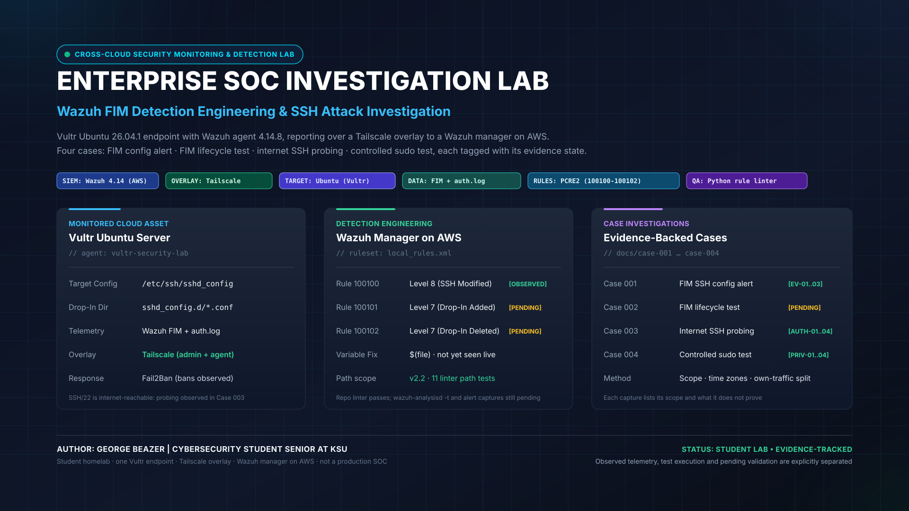
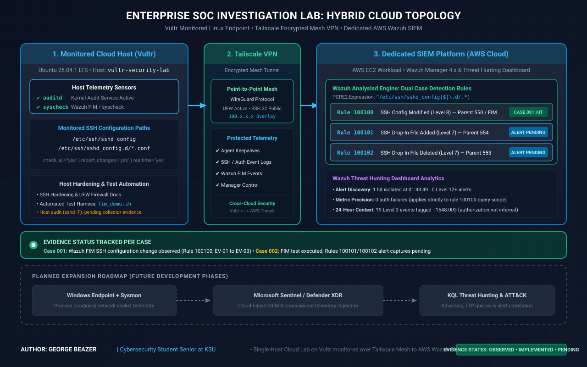
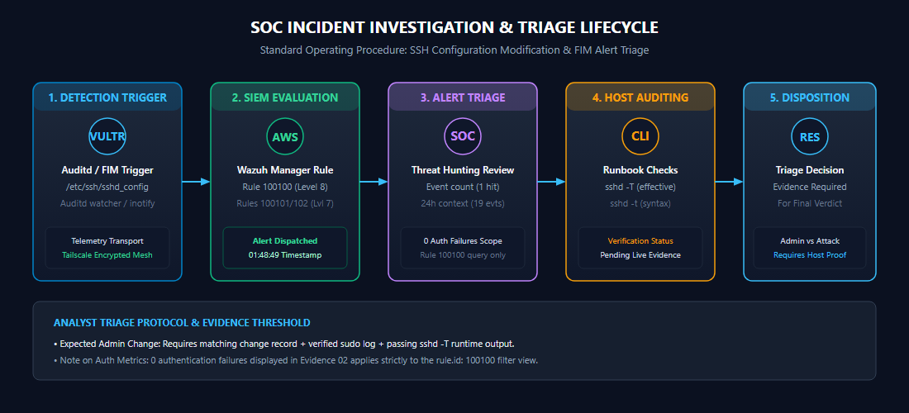

<div align="center">

# Enterprise SOC Investigation Lab
### Hybrid Cloud Detection, Linux FIM, SSH Attack Telemetry and Response

[](https://wazuh.com/)
[](https://tailscale.com/)
[](https://ubuntu.com/)
[](hardening/sshd_hardening_reference.conf)
[](hardening/ufw_reference.md)
[](detections/local_rules.xml)

<br/>

<a href="assets/project-cover.svg">
  
</a>
<sub><i>Presentation graphics retained from the portfolio design work. Technical claims below are tied to documented evidence states.</i></sub>

<br/><br/>

**Author:** **George Beazer** &nbsp;|&nbsp; **Role:** Cybersecurity Student, Senior at KSU &nbsp;|&nbsp; **Environment:** Cloud hosted SOC investigation lab

[Overview](#project-overview) • [Architecture](#lab-architecture) • [Cases](#investigation-cases) • [Evidence](#evidence-and-verification) • [Rules](#custom-detection-rules) • [Status](#implementation-status) • [Roadmap](#roadmap)

</div>

---

<a id="project-overview"></a>
## Project Overview

This repository documents a hands on SOC lab built to practice **detection engineering, Linux security monitoring, alert triage, host log correlation, and evidence based incident analysis**.

The current lab includes a Vultr Ubuntu endpoint named `vultr-security-lab`, a Wazuh manager/dashboard in the cloud lab topology, a Tailscale overlay, Wazuh File Integrity Monitoring, custom rules for OpenSSH configuration changes, UFW, Fail2Ban, auditd, and live SSH authentication telemetry.

The portfolio intentionally separates four evidence states:

| State | Meaning |
|:---|:---|
| **Observed** | Direct telemetry or terminal output was captured from the running lab |
| **Implemented** | Configuration or code exists, but every runtime result is not necessarily captured |
| **Test Executed** | A controlled action was performed, but its expected alert still needs direct Wazuh evidence |
| **Planned** | Future work that is not represented as completed |

> [!IMPORTANT]
> This is a student cybersecurity lab, not a production SOC. The goal is to show sound technical reasoning and reproducible evidence without overstating what the artifacts prove.

### Current evidence backed highlights

* Custom Rule **100100** produced a Level 8 Wazuh FIM alert for an OpenSSH configuration change.
* Review of that alert exposed a real description variable problem in the earlier rule version, leading to a revised `$(file)` based rule design.
* Wazuh default SSH Rule **5710** captured repeated attempts using non existent usernames.
* Wazuh Rule **5712** produced correlated brute force alerts against non existent users.
* Host logs show unsolicited public SSH authentication attempts alongside a known administrative public key login over the private management path.
* Fail2Ban is active and has applied repeated SSH bans.
* UFW is active with default deny incoming, but TCP/22 is currently allowed from Anywhere. The repository documents this exposure rather than presenting the firewall as more restrictive than it is.

---

## Lab at a Glance

| Layer | Component | Current evidence state |
|:---|:---|:---:|
| Endpoint | `vultr-security-lab`, current capture shows Ubuntu 26.04.1 LTS and Wazuh agent 4.14.8 | **Observed** |
| SIEM | Wazuh Threat Hunting and endpoint telemetry | **Observed** |
| Private overlay | Tailscale service and lab peers | **Observed** |
| FIM | Wazuh syscheck/FIM for OpenSSH configuration monitoring | **Observed / being refined** |
| Custom detection | Rules 100100 through 100102 | **100100 observed; 100101 and 100102 pending alert capture** |
| Authentication detection | Rules 5710, 5712, 5715 and sudo Rule 5402 | **Observed** |
| Host firewall | UFW active, default deny incoming, public SSH exception present | **Observed** |
| Reactive defense | Fail2Ban `sshd` jail active | **Observed** |
| Audit subsystem | auditd service active | **Observed; not claimed as the source of Case 001** |
| Rule QA | Python repository linter | **Implemented** |
| Native rule loader test | `wazuh-analysisd -t` | **Pending evidence** |
| SSH effective hardening | `sshd -t` and `sshd -T` evidence | **Pending evidence** |

---

<a id="lab-architecture"></a>
## Lab Architecture

<div align="center">
  <a href="assets/architecture/lab-architecture.svg">
    
  </a>
  <br/>
  <sub><i>Existing portfolio architecture graphic retained. Where a graphic and current evidence state differ, the written evidence status in this README is authoritative.</i></sub>
</div>

### Operational flow

```text
Vultr Ubuntu Endpoint
  |
  | Wazuh agent, FIM, SSH/auth telemetry
  v
Cloud Wazuh Manager and Threat Hunting
  |
  +--> Custom OpenSSH configuration rules
  +--> Default SSH authentication rules
  +--> Analyst triage and evidence correlation

Supporting endpoint controls:
  Tailscale overlay | UFW | Fail2Ban | auditd | OpenSSH
```

The current service snapshot shows Tailscale, Wazuh agent, SSH, Fail2Ban, and auditd active. UFW is also active. The exact live Wazuh destination/transport settings should be verified from the deployed agent configuration before treating a topology diagram as packet level proof.

---

<a id="investigation-cases"></a>
## Investigation Cases

### Case 001: Wazuh FIM SSH Configuration Change

**Status: OBSERVED ALERT, FINAL DISPOSITION PENDING**

Custom Rule 100100 fired once at Level 8 on 14 Oct 2026 at 01:48:49 in the captured dashboard view.

What the evidence proves:

* Rule 100100 fired for `vultr-security-lab`.
* The historical alert description contained a blank trailing value, exposing a rule template issue.
* The filtered dashboard contained one Rule 100100 alert.

What it does not yet prove:

* which exact directive changed,
* who made the change,
* whether it was authorized,
* whether `syscheck.diff` was present,
* whether the revised `$(file)` description has been observed after deployment.

[Read the full Case 001 investigation](docs/case-001-ssh-config-change.md)

### Case 002: Safe FIM Lifecycle Test

**Status: TEST EXECUTED, ALERT VERIFICATION PENDING**

The safe test harness creates, modifies, and deletes a comment only file under `/etc/ssh/sshd_config.d/`. The timeline records those filesystem actions and the rule IDs expected to fire.

The timeline **does not** contain Wazuh alert records for Rules 100101 and 100102. This case will be promoted to verified only after direct alert captures and native manager validation are added.

[Read Case 002 and its definition of done](docs/case-002-fim-lifecycle.md)

### Case 003: SSH Authentication Attack Investigation

**Status: OBSERVED**

November 2026 captures show genuine unsolicited SSH authentication activity against the public SSH service:

* Rule 5710 shows repeated attempts to log in with non existent users.
* Rule 5712 shows Wazuh correlated brute force activity.
* Raw host authentication logs show multiple public source attempts and a separate known administrative public key login.
* Fail2Ban's `sshd` jail is active and has accumulated repeated bans.
* UFW is active, but public TCP/22 remains explicitly allowed.

**Assessment:** the host is receiving real internet SSH credential probing. The supplied artifacts do not prove successful unauthorized access or compromise.

[Read the Case 003 investigation](docs/case-003-ssh-authentication-attacks.md)

---

<a id="custom-detection-rules"></a>
## Custom Detection Rules

`detections/local_rules.xml` contains three custom child rules scoped to OpenSSH configuration paths:

```xml
<group name="syscheck,ssh_configuration_monitoring,">

  <rule id="100100" level="8">
    <if_sid>550</if_sid>
    <field name="file" type="pcre2">^/etc/ssh/sshd_config($|\.d/.*)</field>
    <description>SSH configuration file modified: $(file)</description>
  </rule>

  <rule id="100101" level="7">
    <if_sid>554</if_sid>
    <field name="file" type="pcre2">^/etc/ssh/sshd_config($|\.d/.*)</field>
    <description>SSH configuration file added: $(file)</description>
  </rule>

  <rule id="100102" level="7">
    <if_sid>553</if_sid>
    <field name="file" type="pcre2">^/etc/ssh/sshd_config($|\.d/.*)</field>
    <description>SSH configuration file deleted: $(file)</description>
  </rule>

</group>
```

### Rule verification status

| Rule | Purpose | Status |
|:---:|:---|:---:|
| 100100 | OpenSSH configuration modified | **Observed under earlier rule version; v2 description needs live capture** |
| 100101 | OpenSSH configuration file added | **Authored; alert capture pending** |
| 100102 | OpenSSH configuration file deleted | **Authored; alert capture pending** |

The Python linter checks repository structure and common mistakes. It is **not** an XML schema validator and it does not replace the manager's native validation:

```bash
python3 scripts/lint_rules.py detections/local_rules.xml
sudo /var/ossec/bin/wazuh-analysisd -t
```

### Corrected real time FIM reference

Wazuh real time monitoring is directory based. The repository reference monitors the OpenSSH directory and uses the custom rule regex to narrow the custom alert paths:

```xml
<directories check_all="yes" report_changes="yes" realtime="yes">/etc/ssh</directories>
```

See [detections/ossec_fim_snippet.xml](detections/ossec_fim_snippet.xml).

---

## Investigation Workflow

<div align="center">
  <a href="assets/diagrams/investigation-workflow.svg">
    
  </a>
</div>

The working analyst sequence is:

```text
Alert or event
   -> validate rule and query scope
   -> inspect raw fields
   -> expand to surrounding host activity
   -> correlate auth/audit/host controls
   -> state evidence gaps
   -> assign disposition only when supported
```

[Open the detailed triage runbook](docs/investigation-workflow.md)

---

<a id="evidence-and-verification"></a>
## Evidence and Verification

### Existing Case 001 evidence

<div align="center">
  
</div>

**What it proves:** Custom Rule 100100 produced one Level 8 alert in the captured query.

<div align="center">
  
</div>

**Query scope warning:** authentication counters in this screenshot are filtered to Rule 100100. They cannot be used to conclude that the host had no authentication failures.

<div align="center">
  
</div>

**What it proves:** the search returned 19 Level 3 events with Wazuh's sudo related ATT&CK classification. The ATT&CK tag alone does not establish that every event was authorized or benign.

### New authentication evidence

The November captures supplied for this revision document endpoint state, sudo activity, Rule 5710 invalid user events, Rule 5712 brute force correlation, host authentication logs, and Fail2Ban response.

> [!NOTE]
> Sanitized publication copies of those screenshots should be added under `evidence/observed/` before this branch is merged. The supporting case document is already aligned to the observed fields and intentionally avoids claiming compromise.

[Evidence provenance and publication policy](evidence/README.md)

---

<a id="implementation-status"></a>
## Implementation Status

| Capability | Status | Evidence based interpretation |
|:---|:---:|:---|
| Wazuh endpoint telemetry | **OBSERVED** | Live endpoint and Threat Hunting captures |
| Custom Rule 100100 | **OBSERVED** | Historical Level 8 alert captured |
| Rules 100101 and 100102 | **IMPLEMENTED** | Authored in ruleset; direct alert captures pending |
| FIM lifecycle script | **TEST EXECUTED** | Filesystem actions recorded; expected alerts not yet captured |
| Rule 5710 invalid user telemetry | **OBSERVED** | Repeated non existent user attempts captured |
| Rule 5712 brute force telemetry | **OBSERVED** | Correlated Wazuh brute force alerts captured |
| Rule 5402 sudo telemetry | **OBSERVED** | Successful sudo to root events captured |
| Fail2Ban sshd jail | **OBSERVED** | Active jail and cumulative bans captured |
| UFW | **OBSERVED** | Active, default deny incoming; public TCP/22 exception documented |
| auditd | **OBSERVED SERVICE STATE** | Active service; not used as unsupported proof for Case 001 |
| SSH hardening reference | **REFERENCE** | Intended settings documented; effective `sshd -T` evidence pending |
| Native Wazuh rule validation | **PENDING** | `wazuh-analysisd -t` output still needed |
| Windows, Sentinel, Defender XDR, KQL | **PLANNED** | Future expansion only |

---

<a id="roadmap"></a>
## Roadmap

Highest priority next steps:

1. Run and capture native `wazuh-analysisd -t` validation.
2. Confirm the deployed directory based FIM configuration.
3. Re run the safe FIM lifecycle test and capture Rules 100101, 100100, and 100102.
4. Capture `sshd -t` and sanitized `sshd -T` output.
5. Correlate one hostile source across Wazuh, host logs, and Fail2Ban.
6. Decide whether public SSH remains intentionally exposed for research or is restricted to the management path.
7. Add Windows/Sysmon and Microsoft Sentinel only after the Linux cases are fully evidenced.

[Full roadmap](docs/roadmap.md)

---

## Repository Navigation

```text
assets/
  project-cover.*                  presentation assets
  architecture/                    architecture graphics
  diagrams/                        investigation graphics

detections/
  local_rules.xml                  custom Wazuh FIM rules
  ossec_fim_snippet.xml            corrected reference FIM configuration
  CHANGELOG.md                     rule history and verification status

docs/
  case-001-ssh-config-change.md     observed FIM configuration alert
  case-002-fim-lifecycle.md         controlled FIM test and evidence gaps
  case-003-ssh-authentication-attacks.md
  investigation-workflow.md
  roadmap.md

evidence/
  observed/                         authentic live lab captures
  demo/                             controlled test execution records

hardening/
  sshd_hardening_reference.conf
  ufw_reference.md

scripts/
  collect_lab_evidence.sh
  fim_demo.sh
  lint_rules.py
```

---

## Technical References

* [Wazuh File Integrity Monitoring](https://documentation.wazuh.com/current/user-manual/capabilities/file-integrity/index.html)
* [Wazuh custom FIM rules](https://documentation.wazuh.com/current/user-manual/capabilities/file-integrity/creating-custom-fim-rules.html)
* [Wazuh FIM who data](https://documentation.wazuh.com/current/user-manual/capabilities/file-integrity/advanced-settings.html)
* [MITRE ATT&CK](https://attack.mitre.org/)
* [Tailscale documentation](https://tailscale.com/kb/)

<div align="center">
  <sub>George Beazer • Cybersecurity Student, Senior at KSU • Evidence backed SOC portfolio</sub>
</div>
