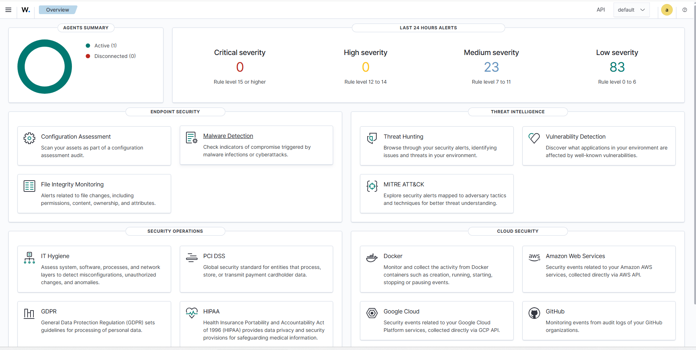
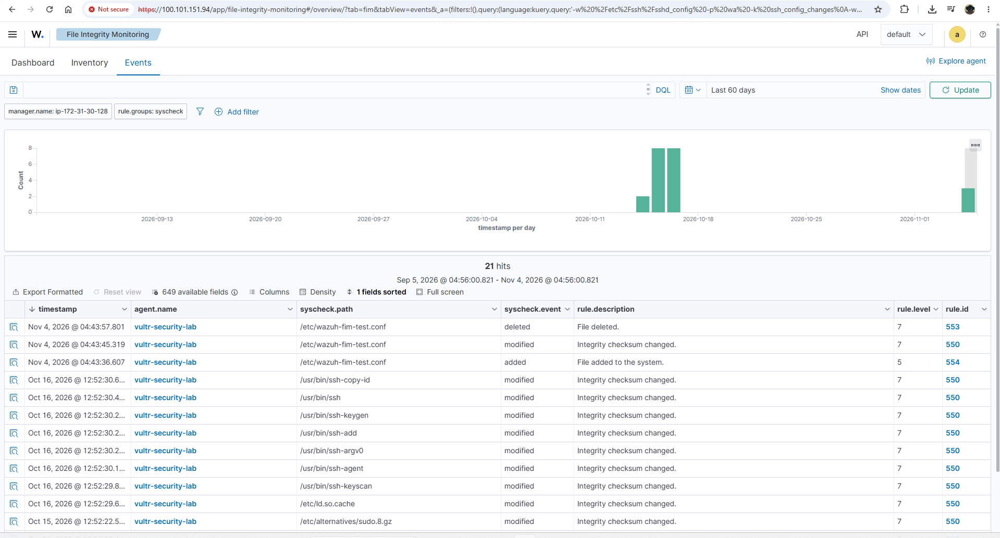

# Case 002: Real Time File Integrity Monitoring

## Objective

Validate that Wazuh can detect file creation, modification, and deletion activity in real time on a monitored Linux endpoint.

The validation focused on `/etc`, a sensitive Linux configuration directory.

The goal was to confirm that file changes generated on the Vultr endpoint were detected by the Wazuh agent, forwarded to the AWS hosted Wazuh SIEM, and made available for centralized analyst investigation.

## Environment

* **Endpoint:** `vultr-security-lab`
* **Operating System:** Ubuntu 26.04.1 LTS
* **Wazuh Agent:** 4.14.8
* **SIEM:** Wazuh 4.14.8
* **Wazuh Manager:** AWS EC2 running Ubuntu 24.04
* **Administrative Connectivity:** Tailscale private network
* **Monitored Directory:** `/etc`

## FIM Configuration

Real time File Integrity Monitoring was enabled for `/etc` on the Vultr endpoint.

```xml
<directories realtime="yes" report_changes="yes">/etc</directories>
```

The `realtime="yes"` setting instructs Wazuh to monitor file activity as changes occur instead of relying only on scheduled integrity scans.

The `report_changes="yes"` setting provides additional visibility into supported file modifications by allowing Wazuh to record change information when available.

This configuration was used to validate monitoring of a sensitive system directory where changes may affect operating system and service configuration.

## Validation Procedure

A controlled test file was created inside `/etc`.

```bash
sudo touch /etc/wazuh-fim-test.conf
```

The file was then modified.

```bash
echo "FIM test change $(date)" | sudo tee /etc/wazuh-fim-test.conf
```

Finally, the test file was deleted.

```bash
sudo rm /etc/wazuh-fim-test.conf
```

All three actions were intentionally generated as part of the validation exercise.

The activity was authorized and should not be interpreted as malicious behavior.

## Detection Results

Wazuh detected the creation, modification, and deletion of the test file.

| Action | Wazuh Rule | Level | Result |
| --- | --- | ---: | --- |
| File created | Rule 554: File added to the system | 5 | Detected |
| File modified | Rule 550: Integrity checksum changed | 7 | Detected |
| File deleted | Rule 553: File deleted | 7 | Detected |

All three events were associated with the monitored endpoint:

```text
vultr-security-lab
```

The affected file was:

```text
/etc/wazuh-fim-test.conf
```

This confirmed that the configured FIM policy was actively monitoring `/etc` and that the endpoint activity was visible in the centralized Wazuh environment.

## Investigation

The Wazuh File Integrity Monitoring and Threat Hunting views were used to review the activity.

The observed sequence was:

```text
File created
    ↓
File modified
    ↓
File deleted
```

The sequence matched the controlled actions performed on the endpoint.

Rule 554 identified the initial creation of the file.

Rule 550 identified the subsequent integrity change after content was written to the file.

Rule 553 identified the removal of the file.

The modification and deletion events were assigned Level 7 alerts, while the creation event was assigned Level 5.

In this validation, those severity values provided additional context for prioritizing the observed file activity. Severity alone, however, does not establish whether a change is malicious.

## Analyst Assessment

The activity was determined to be authorized because the file operations were intentionally generated as part of the lab validation.

In a real investigation, unexpected changes under `/etc` would require additional analysis because the directory contains configuration files that can affect system behavior, authentication, networking, services, and security controls.

An analyst would review additional context such as:

* user responsible for the change
* time of modification
* authentication activity
* sudo activity
* auditd telemetry
* associated process execution
* previous and current file contents when available
* surrounding SSH activity
* related configuration changes

Unexpected file activity could be associated with legitimate administration, software installation, system updates, configuration management, or malicious activity.

A FIM alert therefore identifies a change that requires context. It does not by itself prove compromise.

## Monitoring Workflow

The validated monitoring path was:

```text
Vultr Linux Endpoint
        ↓
Wazuh Agent
        ↓
Tailscale Private Network
        ↓
AWS Wazuh Manager
        ↓
Wazuh Indexer
        ↓
Wazuh Dashboard
        ↓
Analyst Investigation
```

This demonstrated centralized visibility into file activity occurring on a remote cloud Linux endpoint.

## Outcome

This case demonstrated:

* real time Linux file monitoring
* detection of file creation
* detection of file modification
* detection of file deletion
* monitoring of the `/etc` directory
* centralized Wazuh telemetry
* FIM alert investigation
* interpretation of Wazuh rule severity
* correlation of endpoint actions with SIEM events
* distinction between detected activity and confirmed malicious activity

The validation confirmed that the configured FIM monitoring path was functioning as expected for the tested file activity.

## Evidence

### FIM Dashboard



Shows the Wazuh File Integrity Monitoring view associated with the controlled validation activity.

### FIM Events


Shows the creation, modification, and deletion events associated with `/etc/wazuh-fim-test.conf`.

### Detailed Modification Event



Shows additional metadata associated with the Rule 550 integrity change event.

### FIM Investigation Report

[View FIM Investigation Report](../evidence/fim/04_fim_report.pdf)

Provides supporting documentation for the file creation, modification, and deletion events observed during the validation.

## Limitations

This case represents a controlled detection validation exercise and does not document an actual security compromise.

The test demonstrates visibility into file activity for the configured monitored directory and test conditions.

It does not establish attacker identity, intent, or attribution.

Additional telemetry would be required during a real incident to determine who performed a change, which process was responsible, why the change occurred, and whether the activity was authorized.

FIM should therefore be treated as one source of investigation evidence rather than a complete determination of malicious activity.

## Conclusion

The validation demonstrated that Wazuh successfully monitored the selected `/etc` directory and generated alerts for file creation, modification, and deletion activity on the Vultr Linux endpoint.

The resulting events were available in the AWS hosted Wazuh environment for centralized investigation.

The case also demonstrated an important SOC principle: detecting a file change is only the beginning of an investigation. Authentication activity, privilege use, process execution, audit telemetry, and surrounding system events are needed to determine whether the change represents normal administration or suspicious behavior.