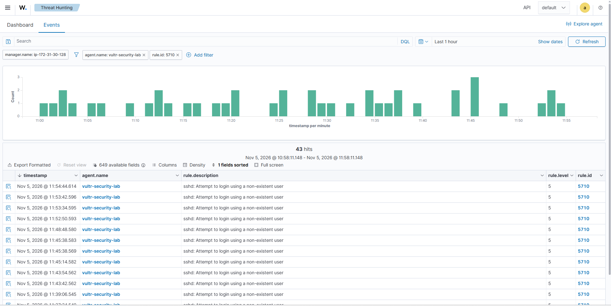
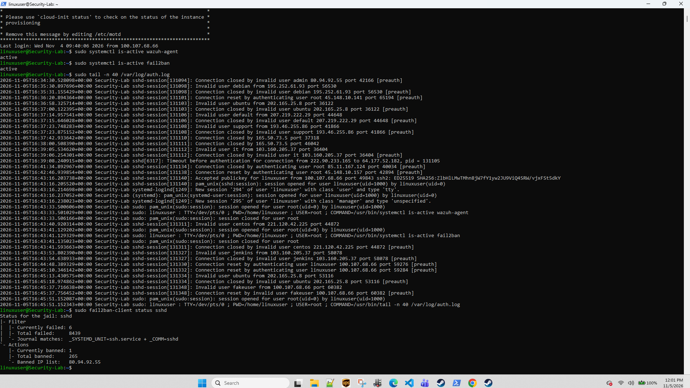
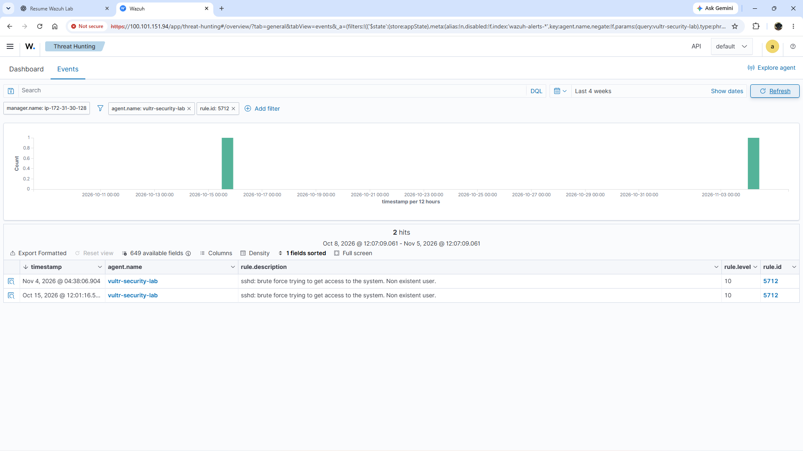
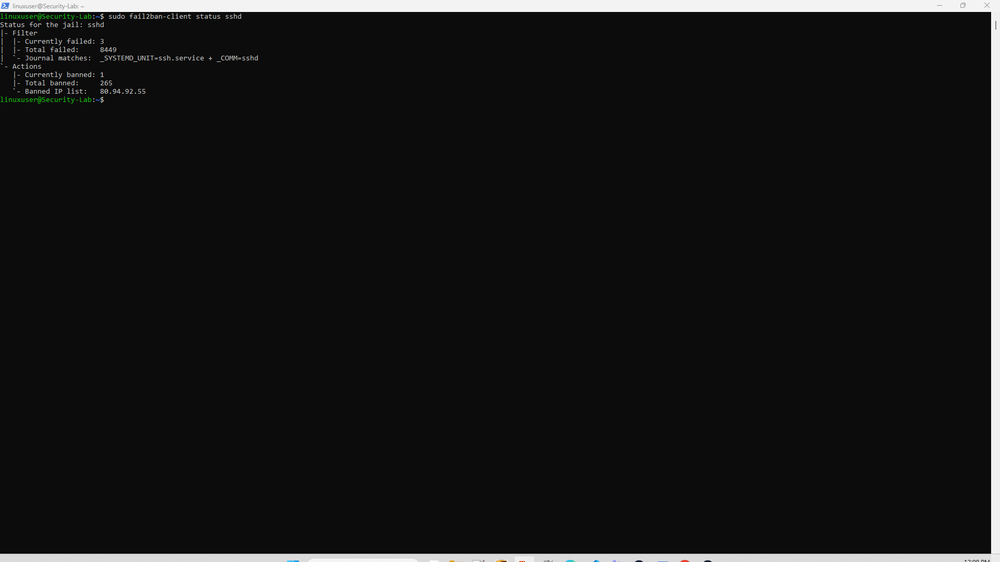

# Case 003 — SSH Authentication and Internet Scanning Investigation

## Objective

Investigate SSH authentication activity on the `vultr-security-lab` endpoint and distinguish legitimate administrative access from suspicious Internet scanning and invalid-user login attempts.

## Environment

- **Endpoint:** `vultr-security-lab`
- **Operating System:** Ubuntu 26.04.1 LTS
- **Wazuh Agent:** 4.14.8
- **SIEM:** AWS-hosted Wazuh 4.14.8
- **Network:** Tailscale private connectivity for authorized administration
- **Additional Control:** Fail2ban protecting SSH

## Observed Activity

The endpoint received repeated SSH connection attempts from external Internet addresses using usernames that did not exist on the system.

Examples observed in the SSH authentication logs included usernames such as:

- `admin`
- `debian`
- `ubuntu`
- `default`
- `support`
- `centos`
- `jenkins`

A controlled invalid-user test using `fakeuser` was also generated from the authorized workstation to validate detection behavior.

## Wazuh Detection

Wazuh Rule 5710 detected repeated attempts to authenticate using non-existent SSH users.

The Threat Hunting view showed numerous Rule 5710 events associated with the `vultr-security-lab` endpoint.

```text
Rule ID: 5710
Description: sshd: Attempt to login using a non-existent user
Level: 5
```

This demonstrated that SSH authentication telemetry from the Vultr endpoint was successfully forwarded to the centralized Wazuh SIEM.

## Legitimate Authentication

A successful SSH login from the authorized Windows workstation was also observed.

The successful session originated over the Tailscale network and authenticated using the configured SSH key for the `linuxuser` account.

This allowed legitimate administrative access to be distinguished from suspicious external login attempts.

## Fail2ban Response

Fail2ban was active on the endpoint and monitoring the SSH service.

During validation, Fail2ban reported:

```text
Total failed attempts: 8439
Total banned: 265
Currently banned: 1
```

This demonstrates a layered defensive model:

```text
Internet SSH activity
        ↓
Linux authentication logs
        ↓
Wazuh detection and centralized visibility
        ↓
Analyst review
        ↓
Fail2ban automated blocking
```

## Analyst Assessment

The repeated invalid-user events were consistent with automated SSH scanning and credential probing commonly observed on Internet-exposed SSH services.

The activity should not automatically be described as a confirmed compromise. No evidence from this case demonstrated successful unauthorized authentication.

The authorized SSH login was distinguishable from the suspicious traffic by reviewing:

- source address
- authenticated username
- authentication result
- Wazuh rule
- event timestamp
- Tailscale context

## Outcome

This case demonstrated:

- SSH authentication monitoring
- detection of invalid-user login attempts
- separation of authorized and unauthorized-looking activity
- centralized Wazuh investigation
- Fail2ban enforcement
- analyst review of authentication telemetry

## Evidence

### Invalid User Detection



### Successful SSH Login



### Brute Force Correlation

If Rule 5712 was observed:



If no Rule 5712 event was observed, this should be documented rather than inferred.

### Fail2ban Status



## Limitations

The presence of repeated SSH login attempts does not by itself prove a successful attack or compromise.

This case documents observed authentication activity, SIEM detections, and defensive controls. Additional telemetry would be required to establish compromise or attacker intent.

## Next Steps

Future work will correlate SSH authentication activity with:

- auditd process activity
- sudo and privilege events
- file integrity alerts
- custom SSH configuration change detections
- additional Wazuh correlation rules

## Investigation Case Studies

### Case 002 — Real-Time File Integrity Monitoring

Configured real-time Wazuh FIM on the Vultr Linux endpoint and validated detection of file creation, modification, and deletion.

Detected:

- Rule 554 — File added to the system
- Rule 550 — Integrity checksum changed
- Rule 553 — File deleted

[View Case 002](cases/case-002-real-time-file-integrity-monitoring.md)

### Case 003 — SSH Authentication and Internet Scanning Investigation

Investigated real SSH authentication activity against the Vultr endpoint, including repeated invalid-user attempts, legitimate administrative access, and Fail2ban enforcement.

Observed:

- Rule 5710 — Attempt to login using a non-existent user
- Rule 5715 — Successful SSH authentication
- Fail2ban automated blocking of repeated offenders

[View Case 003](cases/case-003-ssh-authentication-and-internet-scanning.md)