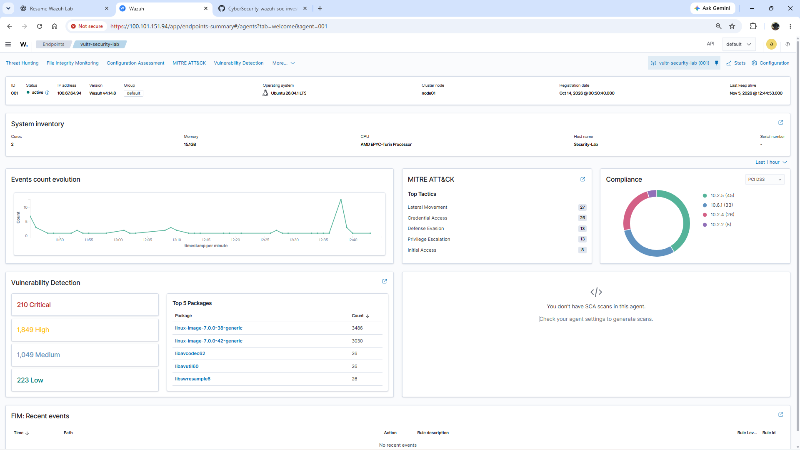
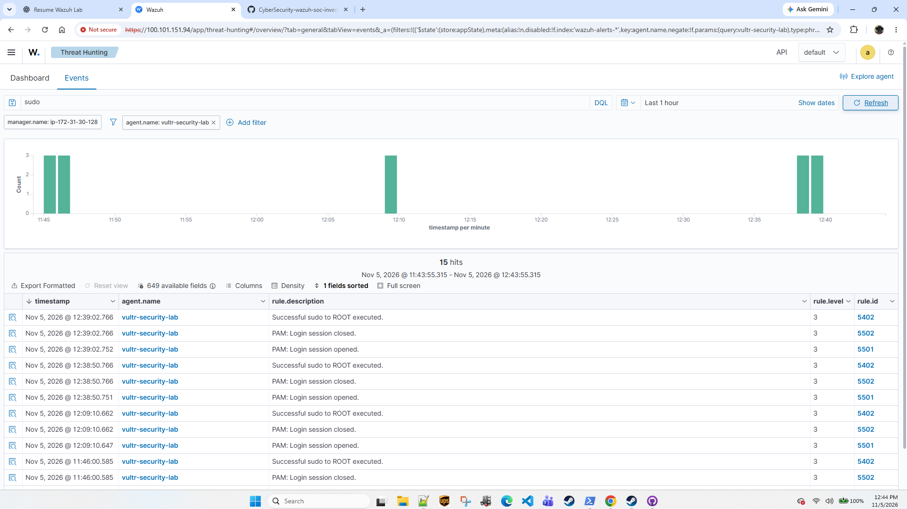
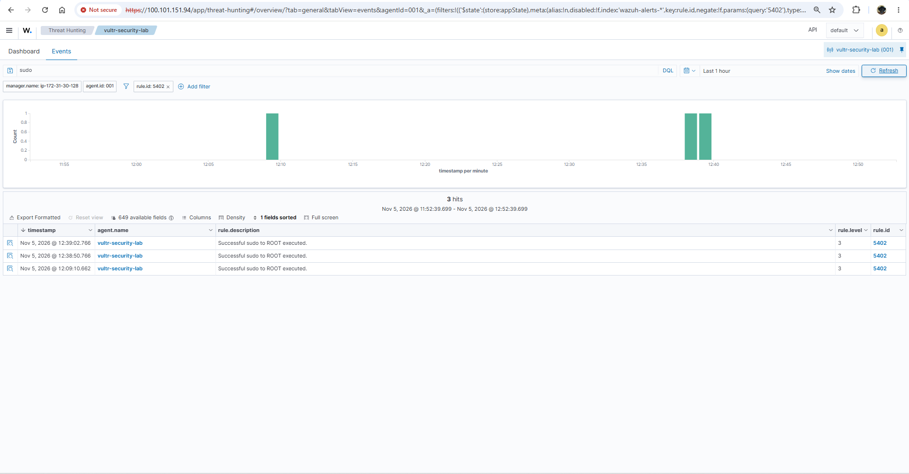
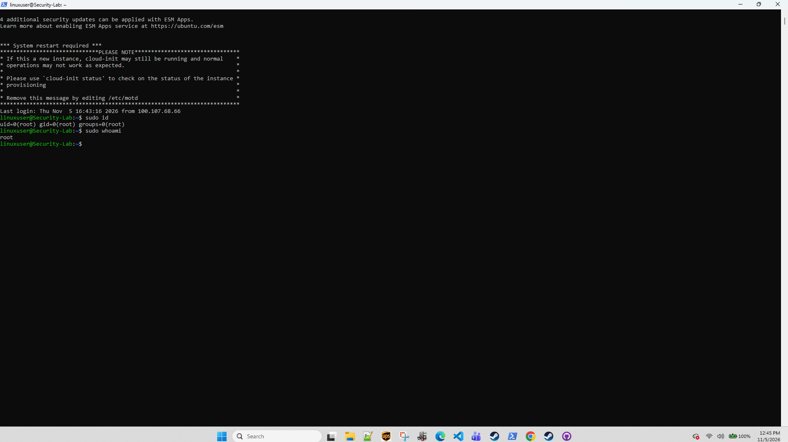

# Case 004 — Sudo and Privilege Activity Investigation

## Objective

Validate that Wazuh can detect and investigate privileged Linux activity when an authorized user executes commands as root through `sudo`.

## Environment

- **Endpoint:** `vultr-security-lab`
- **Operating System:** Ubuntu 26.04.1 LTS
- **Wazuh Agent:** 4.14.8
- **SIEM:** AWS-hosted Wazuh 4.14.8
- **Administrative User:** `linuxuser`

## Test Procedure

Controlled privilege activity was generated on the Vultr endpoint using:

```bash
sudo id
```

and:

```bash
sudo whoami
```

The commands confirmed execution with root privileges:

```text
uid=0(root) gid=0(root) groups=0(root)

root
```

## Detection Results

Wazuh detected the sudo activity and related PAM session events.

| Rule ID | Description | Level |
| --- | --- | ---: |
| 5402 | Successful sudo to ROOT executed. | 3 |
| 5501 | PAM: Login session opened. | 3 |
| 5502 | PAM: Login session closed. | 3 |

Multiple sudo events were visible in Threat Hunting for the `vultr-security-lab` endpoint.

## Investigation

The event sequence demonstrated that privileged command execution generated multiple related security events:

```text
linuxuser executes sudo
        ↓
PAM session opened
        ↓
Successful sudo to ROOT
        ↓
Privileged command executes
        ↓
PAM session closed
```

The activity was authorized and intentionally generated as part of the validation exercise.

## Analyst Assessment

A successful sudo event is not automatically malicious.

In a real investigation, an analyst would review:

- originating user
- command executed
- timestamp
- authentication context
- source session
- surrounding SSH activity
- related auditd telemetry
- file changes occurring after privilege escalation

Unexpected sudo activity could indicate unauthorized administrative access, credential misuse, or post-compromise privilege escalation.

## Outcome

This case demonstrated:

- monitoring of Linux sudo activity
- detection of successful sudo-to-root execution
- Wazuh Rule 5402 alerting
- PAM session monitoring
- centralized Wazuh analysis
- correlation between controlled terminal activity and SIEM detections
- distinction between authorized administrative activity and potentially suspicious privilege use

## Evidence

### Endpoint Overview



Shows the monitored `vultr-security-lab` endpoint in Wazuh, including the active agent, operating system, and current security telemetry.

### Sudo Detection Overview



Shows sudo-related events detected in Wazuh Threat Hunting, including successful sudo-to-root activity and related PAM session events.

### Rule 5402 Dashboard


Shows the Wazuh dashboard filtered specifically to Rule 5402, confirming multiple `Successful sudo to ROOT executed` alerts.

### Sudo Event Details



Shows Rule 5402 events associated with the `vultr-security-lab` endpoint, including timestamps, severity, and rule information.

### Controlled Privilege Commands



Shows the controlled commands used to validate privileged execution:

```bash
sudo id
sudo whoami
```

The output confirmed that the commands executed with root privileges.

## Limitations

This activity was intentionally generated by an authorized administrator and does not represent a real compromise.

The detection validates visibility into sudo activity but does not by itself establish malicious privilege escalation.

## Next Steps

Future investigations could correlate sudo events with:

- SSH authentication activity
- auditd process execution
- file integrity changes
- unusual command execution
- unauthorized configuration changes