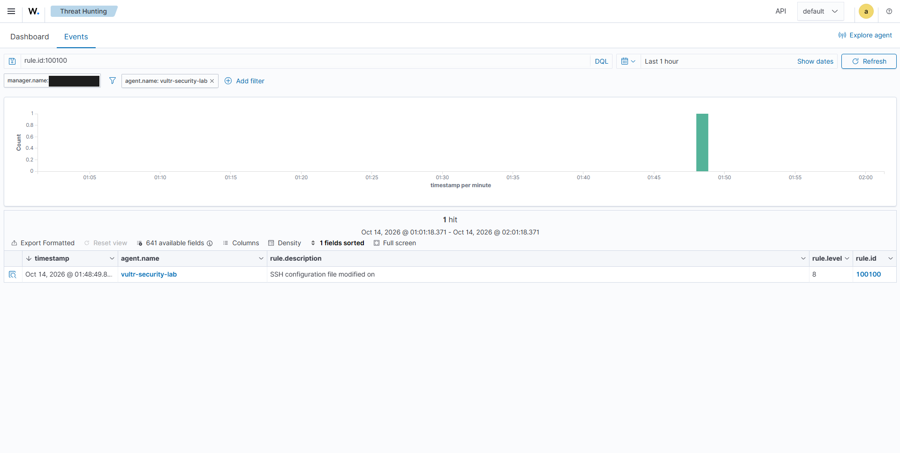
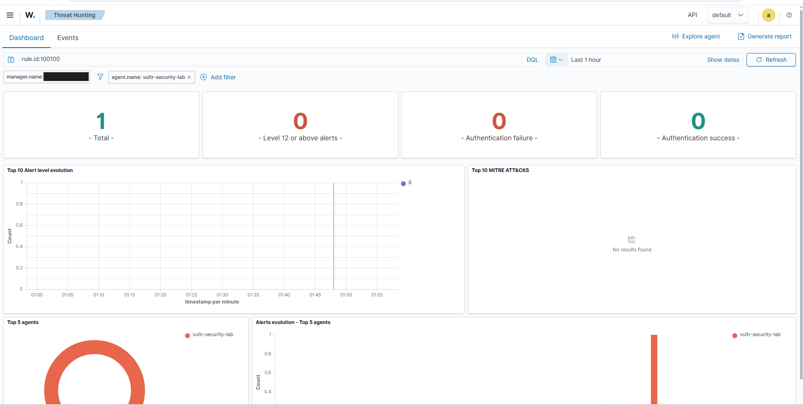
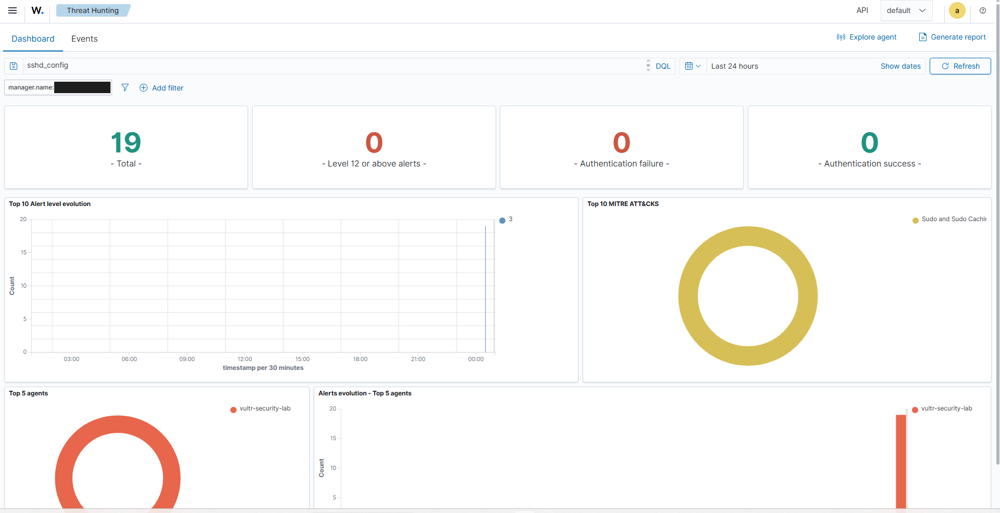

# Case 001: Wazuh FIM Alert on an SSH Configuration Change

## Summary

| | |
|:---|:---|
| **Alert** | Custom Rule 100100, Level 8. The current rule uses FIM parent 550, but the v1 rule text and parent field are not captured. |
| **Asset** | `vultr-security-lab` (agent 001, Ubuntu 26.04.1 LTS, Wazuh agent v4.14.8) |
| **Alert time** | 14 Oct 2026, 01:48:49, dashboard local time (EDT, UTC−4) = 05:48:49 UTC. The October captures don't show a clock; EDT is the only reading that puts the alert after the agent's registration time |
| **Context** | The agent was enrolled the same night, at 00:50:40 local (EP-01), so the alert fired about an hour after enrollment, during initial setup |
| **Status** | Alert observed; the changed file, the change itself, the actor and authorization are **not yet verified** |
| **Disposition** | **Pending.** Not "benign change", not "malicious tampering" |

## Why this case matters

Changes to `/etc/ssh/sshd_config` or its drop-ins can change who can log in and how. The case starts from a real alert from a rule I wrote, checks what the dashboard actually proves, and stops short of a disposition the evidence can't support. It also produced a real troubleshooting result: the alert's description was blank, which exposed a bug in my rule template.

## What this case demonstrates

This case is useful because the detection itself became part of the investigation. I was not only reviewing a Wazuh alert; I was evaluating whether the rule I wrote gave me enough information to investigate the event properly.

The first live alert exposed a weakness in my own rule design: the description rendered without the context I expected. I corrected the template, narrowed the path logic in later revisions, and documented the exact evidence still needed before I would call the change authorized or malicious.

That is the main skill demonstrated here: **building a detection, testing it against real telemetry, finding where it falls short, and improving the detection instead of trusting it because it fired.**

---

## Evidence

### EV-01: The Rule 100100 alert

<div align="center">
  
</div>

**Observed:** Threat Hunting → Events, query `rule.id:100100`, filter `agent.name: vultr-security-lab`, window 14 Oct 2026 01:01:18–02:01:18 (local). One hit at 01:48:49, Level 8, description `SSH configuration file modified on ` with nothing after "on".

**Why it matters:** a rule I wrote fired on the live endpoint. The blank description led me to the template bug, fixed in v2 (see Detection basis).

**What it does not prove:** which file changed, what changed, who changed it, or whether it was authorized. The description is empty and the event fields are not expanded.

### EV-02: The same alert on the Dashboard tab

<div align="center">
  
</div>

**Observed:** same query and filter, last hour. Total 1; Level 12 or above 0; Authentication failure 0; Authentication success 0. Level evolution shows a single Level 8 event. Top MITRE ATT&CK: *No results found*.

**Why it matters:** this confirms the level, and it shows the custom rule carries no ATT&CK tag. Child rules don't inherit their parent's tags.

**What it does not prove:** anything about authentication on the host. The authentication counters are computed inside the `rule.id:100100` filter, so "0 failures" describes the filter, not the host.

### EV-03: Free-text search for `sshd_config`, 24 hours

<div align="center">
  
</div>

**Observed:** Dashboard tab, free-text query `sshd_config`, last 24 hours. 19 events, all Level 3, all from `vultr-security-lab`. Top MITRE ATT&CK: *Sudo and Sudo Caching* (T1548.003). The events sit in one 30-minute bucket just after 00:00, and the chart's time axis ends at about **00:57**. The capture does not show a date.

**Why it matters:** it shows privileged (sudo) activity whose log text mentions `sshd_config`, most likely sudo commands that opened or edited the file. The T1548.003 tag is how Wazuh labels successful sudo, so these are sudo events.

**What it does not prove:** anything about the 01:48:49 change. The Level 8 Rule 100100 alert is **not in this view**, since only Level 3 appears in the level legend. So this capture was taken before the alert, or covers a different window. If it was taken on 14 Oct, the agent had been enrolled at 00:50:40, which puts the 19 events between 00:50 and 00:57, about 50 minutes **before** the alert. Treat it as background on my earlier SSH configuration work, not as context at the alert time. The ATT&CK tag says nothing about authorization.

> **Correction.** Earlier versions of this page presented EV-03 as context around the Rule 100100 alert. The time axis and level legend show it can't be.

---

## Detection basis

The current Rule 100100 definition is a child of built-in FIM Rule 550 (*Integrity checksum changed*, level 7). That supports the intended FIM design. However, the event screenshot only shows the v1 rule ID, description and level; the v1 rule file and expanded event are missing. I cannot independently verify its parent rule or even the precise file path from that screenshot. There is no evidence of auditd involvement in this alert.

Current rule (v2.2, not yet observed firing):

```xml
<rule id="100100" level="8">
  <if_sid>550</if_sid>
  <field name="file" type="pcre2">^/etc/ssh/sshd_config(\.d/[^/]+\.conf)?$</field>
  <description>SSH configuration file modified: $(file)</description>
</rule>
```

The **observed** alert came from the v1 rule. Its description template used `$(agent.name)`, which rendered empty, most likely because `agent.name` is not a decoded event field. v2 uses `$(file)`, a decoded FIM field that Wazuh's own custom-FIM examples use. That fix is unconfirmed until a new alert shows the path in its description.

The v2 path pattern matched **any** file under `sshd_config.d/`, including editor temp files; v2.2 narrows it to `*.conf` drop-ins (see `detections/CHANGELOG.md`). The v1 rule text is not preserved, so its exact path scope is unknown. EV-01 cannot establish whether the event was for the main config, a drop-in, or another file.

## Evidence gaps

| What is needed | Where to get it | Status |
|:---|:---|:---:|
| Which file changed | Expand the 01:48:49 event: `syscheck.path` | Pending |
| What changed | `syscheck.changed_attributes`, `syscheck.sha256_before` / `_after`, and `syscheck.diff` if `report_changes` was on | Pending |
| Whether real-time FIM was live | The same event's `syscheck.mode` (`realtime`, `scheduled` or `whodata`) | Pending |
| Who made the change | A free-text `sshd_config` search for 01:30–01:50 on 14 Oct (a sudo `COMMAND=` line right before 01:48:49 would name the user and command) | Pending |
| Is the config valid / what is in effect | `sudo sshd -t`, `sudo sshd -T` | Pending |
| Was it authorized | My own change notes for that night, matched to the time | Pending |

If the October alerts are still in the Wazuh indexer, the first four rows can be closed from the dashboard today, without touching the endpoint.

## Analyst conclusion

**Verified:** Rule 100100 fired once at Level 8 for this agent, about an hour after enrollment. The current rule uses FIM parent 550, but the historical alert's parent field was not captured.

**Not verified:** the changed file, the change, the actor, whether the change was authorized, and whether the v2 `$(file)` description works.

The timing, during my own setup work that night, makes an operator change plausible. Plausible is not evidence, so the disposition stays **pending** until the expanded event and a matching sudo record are captured.
