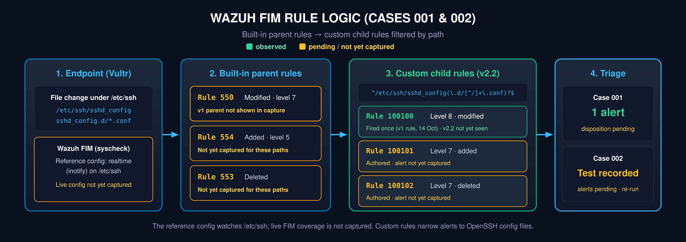

# Case 002: Safe FIM Lifecycle Test for the SSH Drop-in Directory

## Summary

| | |
|:---|:---|
| **Purpose** | Exercise create, modify and delete in the OpenSSH drop-in directory without changing SSH behaviour |
| **Target** | `/etc/ssh/sshd_config.d/99-fim-demo.conf` (comment-only file) |
| **Harness** | `scripts/fim_demo.sh` |
| **Expected rules** | Create → 100101, Modify → 100100, Delete → 100102 |
| **Status** | **Test recorded; Wazuh alerts not captured. The recorded run cannot be matched to the current agent, so it must be re-run.** |

## Detection flow

<div align="center">
  
</div>

Green marks what has been observed; amber marks what is still pending.

## Recorded test

`evidence/demo/fim_demo_timeline.txt` records three filesystem actions (UTC):

```text
2026-10-14T02:15:10Z  CREATED  /etc/ssh/sshd_config.d/99-fim-demo.conf  (expect rule 100101)
2026-10-14T02:15:20Z  MODIFIED /etc/ssh/sshd_config.d/99-fim-demo.conf  (expect rule 100100)
2026-10-14T02:16:05Z  DELETED  /etc/ssh/sshd_config.d/99-fim-demo.conf  (expect rule 100102)
```

**What it proves:** a run of the test script recorded these actions. The 10-second gap between create and modify matches the script's default sleep.

**What it does not prove:**

- **That Wazuh alerted.** There are no Wazuh screenshots or exported alerts for these actions.
- **That this run happened against the agent in the other cases.** The timeline is UTC: 02:15Z on 14 Oct is 22:15 EDT on **13 Oct**. EP-01 shows the current agent was registered on 14 Oct at 00:50:40 EDT, which is 04:50:40 UTC, about 2.5 hours *after* this run. One explanation would be that the agent or manager was re-installed or re-enrolled after the test. Whatever the reason, this run cannot be matched to alerts from the current enrollment.
- The timeline's line format (`(expect rule 100101)`) is older than the current script, which now adds `; verify in Wazuh` and a SHA-256 per step. That fits an earlier script version.

## Expected detection logic

| Action | Built-in parent | Custom child | Evidence |
|:---|:---:|:---:|:---|
| File modified | 550 (level 7) | 100100 (level 8) | v1 rule ID fired once (Case 001); its parent/path not expanded; v2.2 not yet seen |
| File added | 554 (level 5) | 100101 (level 7) | Authored; no alert captured |
| File deleted | 553 | 100102 (level 7) | Authored; no alert captured |

Real-time FIM in Wazuh works on directories, not single files, so the reference config watches `/etc/ssh` (`detections/ossec_fim_snippet.xml`). The rules' path pattern then narrows alerts to `sshd_config` and `*.conf` drop-ins.

## Definition of done

Case 002 becomes **verified** only when all of these exist:

1. `sudo /var/ossec/bin/wazuh-analysisd -t` passes on the manager with the v2.2 rules deployed.
2. The live agent configuration shows a real-time FIM entry covering `/etc/ssh` (from `scripts/collect_lab_evidence.sh` or an `ossec.conf` capture).
3. A new run of `scripts/fim_demo.sh`, with its timeline committed.
4. Wazuh captures of 100101 (create), 100100 (modify) and 100102 (delete), with the v2 `$(file)` description showing the path.
5. For create and modify, the alert's `syscheck.sha256_after` equals the SHA-256 in the timeline, which ties each alert to the test action.
6. The Rule 5402 alert for the `sudo … fim_demo.sh` command, which shows who ran the test.
7. If claiming content diffs, an expanded event showing `syscheck.diff`.

When those captures exist, they go here in order: **create 100101 → modify 100100 → delete 100102**.
