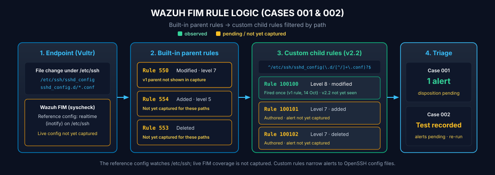

# Case 002: Safe FIM Lifecycle Test Harness

## Executive Summary

| Attribute | Investigation Details |
|:---|:---|
| **Purpose** | Exercise create, modify, and delete actions in the OpenSSH drop in directory without changing SSH behavior |
| **Target** | `/etc/ssh/sshd_config.d/99-fim-demo.conf` |
| **Test Harness** | `scripts/fim_demo.sh` |
| **Expected Custom Rules** | Create 100101, Modify 100100, Delete 100102 |
| **Current Verification Status** | **TEST EXECUTED; WAZUH ALERT CAPTURE PENDING** |

## Visual Detection Flow

<div align="center">
  
</div>

This diagram represents the intended FIM detection flow. The **status table and direct evidence below are authoritative** if a graphic contains older wording.

## Recorded Test Evidence

The file `evidence/demo/fim_demo_timeline.txt` records that the demo script performed three filesystem actions:

```text
2026-10-14T02:15:10Z  CREATED  /etc/ssh/sshd_config.d/99-fim-demo.conf  (expect rule 100101)
2026-10-14T02:15:20Z  MODIFIED /etc/ssh/sshd_config.d/99-fim-demo.conf  (expect rule 100100)
2026-10-14T02:16:05Z  DELETED  /etc/ssh/sshd_config.d/99-fim-demo.conf  (expect rule 100102)
```

### What this evidence proves

The script executed the controlled create, modify, and delete operations.

### What it does not yet prove

There are currently no committed Wazuh screenshots or exported alert records showing all three expected custom alerts for this test.

That is why the case is deliberately labeled **test executed** rather than **verified lifecycle detection**.

## Expected Detection Logic

| Action | Built in FIM Parent | Custom Child | Evidence State |
|:---|:---:|:---:|:---|
| File modified | 550 | 100100 | Historical custom rule firing exists in Case 001; v2 lifecycle capture pending |
| File added | 554 | 100101 | Authored; direct Wazuh alert capture pending |
| File deleted | 553 | 100102 | Authored; direct Wazuh alert capture pending |

## Corrected Real Time FIM Reference

Wazuh real time FIM works on directories. The repository reference therefore monitors `/etc/ssh` and lets the custom path regex narrow custom alerts to `sshd_config` and `sshd_config.d/*`.

See `detections/ossec_fim_snippet.xml`.

## Definition of Done

Case 002 becomes **VERIFIED** only after all of the following are present:

1. Native manager validation passes with `sudo /var/ossec/bin/wazuh-analysisd -t`.
2. The corrected directory based FIM configuration is confirmed on the live agent.
3. A Wazuh Threat Hunting capture shows Rule 100101 for create.
4. A Wazuh Threat Hunting capture shows Rule 100100 using the v2 `$(file)` description for modify.
5. A Wazuh Threat Hunting capture shows Rule 100102 for delete.
6. If claiming content change reporting, an expanded event shows `syscheck.diff`.

## Planned Evidence Gallery

When those screenshots are captured, this page should display them here in sequence:

**Create alert 100101 → Modify alert 100100 → Delete alert 100102**

That visual sequence will be more useful to a hiring manager than simply stating that the test passed.
