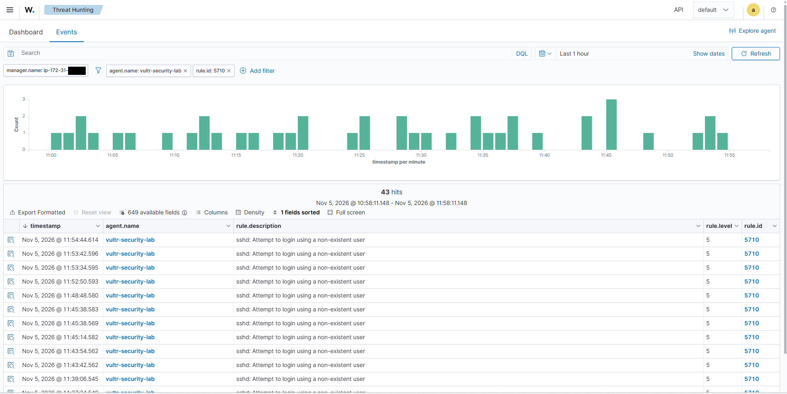
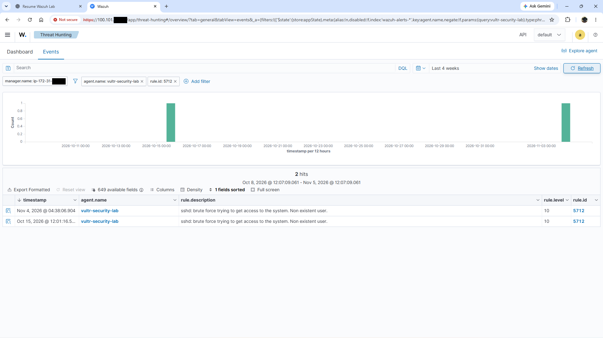
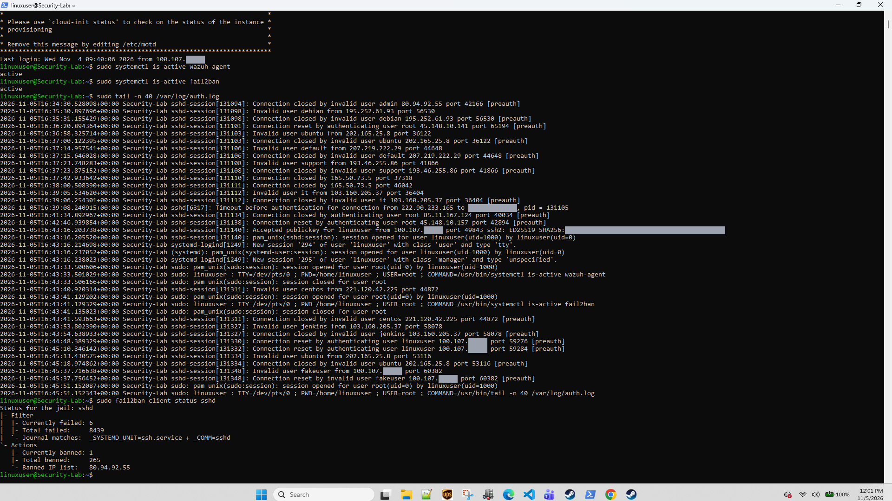
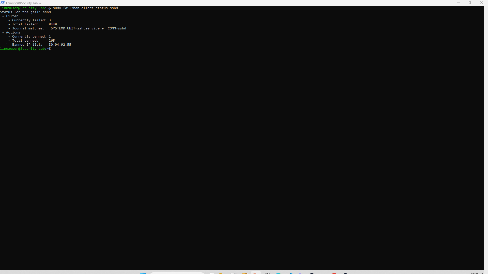

# Case 003: Internet SSH Probing — Wazuh Rules 5710/5712, Host Logs and Fail2Ban

## Summary

| | |
|:---|:---|
| **Asset** | `vultr-security-lab` (agent 001, Ubuntu 26.04.1 LTS, Wazuh agent v4.14.8) |
| **When** | Main review window: 5 Nov 2026, roughly 11:34–12:09 EST (16:34–17:09 UTC). Rule 5712 history: last 4 weeks. |
| **Data sources** | Wazuh alerts (Rules 5710, 5712), `/var/log/auth.log` on the host, `fail2ban-client` |
| **What happened** | Many internet hosts tried to log in over SSH with usernames that don't exist (admin, debian, ubuntu, default, support, it, centos, jenkins) and with `root`. Wazuh alerted, Fail2Ban banned repeat sources, and none of the reviewed log lines show a successful login from the internet. |
| **Disposition** | **True positive: opportunistic, unsuccessful SSH probing** in the data reviewed. The two `fakeuser` alerts are a **benign true positive** (my own test). No incident declared. |
| **Open item** | A full review of *successful* SSH logins for the period has not been done yet (see Next steps). |

> [!NOTE]
> **Time zones.** The Wazuh dashboard shows browser local time (US Eastern, EST = UTC−5 on 5 Nov). The host's `auth.log` uses UTC (`+00:00`). So 11:43 on the dashboard is 16:43 in the host log. Wazuh's `timestamp` is when the manager processed the event; in these captures it is about one second after the host log line.

---

## Evidence

### AUTH-01: Rule 5710, one hour

  

**Observed:** Threat Hunting → Events, filters `agent.name: vultr-security-lab` and `rule.id: 5710`, last 1 hour (5 Nov 2026, 10:58:11–11:58:11 EST). 43 hits, all *sshd: Attempt to login using a non-existent user*, level 5, spread at one to three per minute.

**Why it matters:** a steady, low rate of invalid-username attempts is what internet-wide SSH scanning looks like.

**What it does not prove:** that there were 43 attackers or even 43 attempts. Two of these alerts (11:45:38.569 and 11:45:38.583) line up with my own `fakeuser` test (see below), and one attempt can create more than one alert. Source IPs and usernames are not visible in this view. It says nothing about successful logins.

### AUTH-02: Rule 5712, four weeks

  

**Observed:** Events, `rule.id: 5712`, last 4 weeks (8 Oct 12:07 – 5 Nov 12:07). Two hits: 15 Oct 2026 12:01:16 and 4 Nov 2026 04:38:06 (dashboard local time), *sshd: brute force trying to get access to the system. Non existent user.*, level 10.

**Why it matters:** 5712 is a *composite* rule. It does not fire on one event; it fires when 5710 repeats from the **same source IP** within a short window. Wazuh's documented version of the rule uses 8 matches in 120 seconds (`frequency="8" timeframe="120"` with `<same_source_ip />`). Confirm the values on the manager before quoting them: `grep -A8 'id="5712"' /var/ossec/ruleset/rules/0095-sshd_rules.xml`.

**What it does not prove:** which source triggered it (fields not expanded), that passwords were guessed, or that anyone got in. The window starts on 8 Oct, but the agent was enrolled on 14 Oct (EP-01), so the real coverage is about three weeks.

### AUTH-03: Host log, service state and Fail2Ban (captured 12:01 EST)

  

**Observed:** an SSH session on the endpoint running:

- `sudo systemctl is-active wazuh-agent` → `active`
- `sudo systemctl is-active fail2ban` → `active`
- `sudo tail -n 40 /var/log/auth.log` → 16:34:30–16:45:51 UTC
- `sudo fail2ban-client status sshd` → currently failed 6, total failed 8,439, currently banned 1, total banned 265, banned list `80.94.92.55`

In those ~11 minutes the log shows **12 distinct public source addresses**, invalid users (admin, debian, ubuntu ×2, default, support, it, centos, jenkins), three `root` attempts that ended before authentication (`Connection reset/closed by authenticating user root … [preauth]`), and one `Timeout before authentication` for a connection made to the host's public IP. It also shows my own activity: an accepted public-key login, three sudo commands with their `COMMAND=` lines, and a `fakeuser` attempt.

**Why it matters:** this is host-side ground truth for the Wazuh alerts. It lets me match alerts to log lines, separate my traffic from internet traffic, and tie one source to a Fail2Ban ban.

**What it does not prove:** 40 lines is an 11-minute slice, not a history. The Fail2Ban totals are counters since the Fail2Ban service last started, and that start time was not captured. The jail thresholds (`maxretry`, `findtime`, `bantime`) are not shown.

*Redacted:* the last two octets of my Tailscale addresses, the host's public IP, and the SSH key fingerprint hash.

### AUTH-04: Fail2Ban follow-up (about 12:09 EST)

  

**Observed:** currently failed 3, total failed 8,449, currently banned 1, total banned 265, banned list still `80.94.92.55`.

**Why it matters:** total failures went up by 10 in about 23 minutes while total bans stayed at 265. `80.94.92.55` was still banned about 35 minutes after its last logged attempt (16:34:30 UTC), which suggests a ban time longer than Fail2Ban's stock 10-minute default.

**What it does not prove:** the configured ban time (check with `sudo fail2ban-client get sshd bantime`), or why no new bans happened. The likely reason is that no single source reached the threshold, but the threshold was not captured.

---

## Correlation: Wazuh alerts ↔ host log

The Rule 5710 rows visible in AUTH-01 that overlap the captured `auth.log` slice can be matched to `Invalid user` lines in AUTH-03. This does not reconcile all 43 alerts in the full hour:

| Wazuh 5710 (EST) | `auth.log` line (UTC) | Source | Username | Classification |
|:---|:---|:---|:---|:---|
| 11:37:24.540 *(last row, partly cut off)* | 16:37:23.748 `Invalid user support` | 193.46.255.86 | support | Internet |
| 11:39:06.545 | 16:39:05.534 `Invalid user it` | 103.160.205.37 | it | Internet |
| 11:43:42.562 | 16:43:40.920 `Invalid user centos` | 221.120.42.225 | centos | Internet |
| 11:43:54.562 | 16:43:53.802 `Invalid user jenkins` | 103.160.205.37 | jenkins | Internet (same source as `it`, 5 min later) |
| 11:45:14.582 | 16:45:13.430 `Invalid user ubuntu` | 202.165.25.8 | ubuntu | Internet (same source tried `ubuntu` at 16:36:58) |
| 11:45:38.569 **and** 11:45:38.583 | 16:45:37.716 `Invalid user fakeuser` and 16:45:37.756 `Connection reset by invalid user fakeuser` | 100.107.x.x (my admin workstation) | fakeuser | **My own test** |

What the matching shows:

- **Pipeline latency is about one second** (0.8–1.6 s between the host log line and the Wazuh alert).
- **One attempt can produce two alerts.** Each fully visible internet attempt (`it`, `centos`, `jenkins`, `ubuntu`) produced exactly one 5710 alert, even though each also wrote a `Connection closed by invalid user … [preauth]` line. The `fakeuser` attempt produced two alerts, apparently because its second line said `Connection reset by invalid user` instead of `closed`. I have not confirmed which rule each line hits. The test is quick: paste both lines into `/var/ossec/bin/wazuh-logtest` on the manager.
- **Alert counts are not attempt counts, and attempt counts are not attacker counts.**

## Separating my own traffic

The source `100.107.x.x` is my admin workstation's Tailscale address. In the same log slice it has:

| UTC | Line | What it is |
|:---|:---|:---|
| 16:43:16 | `Accepted publickey for linuxuser … ED25519` | My SSH login over Tailscale, key-based |
| 16:43:33, 16:43:41, 16:45:51 | `sudo: linuxuser : … COMMAND=…` | The three sudo commands at the top of the AUTH-03 terminal |
| 16:44:48, 16:45:10 | `Connection reset by authenticating user linuxuser … [preauth]` | Two aborted connections from my workstation; cause not recorded |
| 16:45:37 | `Invalid user fakeuser` | A test login with a username that doesn't exist |

These are excluded from the internet analysis. The two `fakeuser` alerts are my test traffic inside the 43-hit total.

One side effect to check: failures from my own address can count toward a Fail2Ban ban of that address. `sudo fail2ban-client get sshd ignoreip` shows whether it is exempt. Exempting the whole `100.64.0.0/10` range is convenient, but it would also stop Fail2Ban from rate-limiting a compromised tailnet device.

## One source across host log and Fail2Ban

`80.94.92.55` appears in the host log at 16:34:30 UTC (`Connection closed by invalid user admin 80.94.92.55 port 42166 [preauth]`) and is the address on Fail2Ban's banned list in both AUTH-03 and AUTH-04.

That links host log → Fail2Ban for one source. The Wazuh side for this address is **not shown**: its 5710 alert would be at about 11:34:31 EST, below the visible rows of AUTH-01, and the source IP column is not displayed. Next capture: filter Wazuh on `data.srcip: 80.94.92.55` and expand one event.

## Why only two 5712 alerts in four weeks?

The pattern in the host log explains most of it. The sources are many and spread out: 12 addresses in 11 minutes, mostly one or two attempts each, so few if any reach 8 attempts from one IP inside two minutes. Fail2Ban banning repeat sources would also cut a burst short before it reaches the 5712 threshold. That second point is a reasonable inference, not something the captures prove, because the jail thresholds were not recorded.

## What the activity is, in precise terms

- **Invalid-user probing and `root` attempts that ended before authentication** (`[preauth]`). Wazuh's 5712 description calls it "brute force"; I describe the observed behaviour instead.
- **No `Failed password` lines appear in this window.** That is consistent with password authentication being disabled, where clients without an accepted key are refused and disconnect. It is not proof: only 40 lines were reviewed and `sshd -T` was not captured.
- **SSH is reachable from the internet.** The log shows public sources reaching sshd, including a connection logged to the host's public IP. The UFW rule set that allows this has not been captured (see `hardening/ufw_reference.md`).

A technical note on Fail2Ban: its status shows `Journal matches: _SYSTEMD_UNIT=ssh.service + _COMM=sshd`. It reads the systemd journal, not `auth.log`, and `+` means OR in journal match syntax. On this OpenSSH version the per-connection messages come from `sshd-session`, which still runs inside `ssh.service`, so the unit match covers them. The rising "Total failed" count shows the filter is matching.

## Assessment

- **Finding:** routine internet SSH probing against a publicly reachable SSH service. Wazuh detected it (5710 per attempt, 5712 on bursts) and Fail2Ban banned repeat sources.
- **Compromise:** none of the reviewed artifacts show a successful login from an internet source. The only accepted login in the reviewed slice is my own key-based login from my Tailscale address. That is *not* the same as proving no compromise happened, because a full review of successful logins has not been done.
- **Disposition:** true positive, unsuccessful probing; no escalation. The `fakeuser` alerts are a benign true positive (operator test).

## Next steps (what I would do in a SOC)

1. **Review every successful SSH login for the period.** Wazuh: `rule.groups: authentication_success` (or the sshd success rule) over 30 days. Host: `journalctl -u ssh | grep Accepted`. Every success should be the admin key from a Tailscale address.
2. **Finish the cross-tool trace for one source** (`80.94.92.55`): expanded Wazuh event with `data.srcip`, host log line, Fail2Ban ban.
3. **Record the Fail2Ban thresholds** (`maxretry`, `findtime`, `bantime`, `ignoreip`).
4. **Decide on exposure.** Either restrict TCP/22 to `tailscale0`, or keep it public on purpose for telemetry and document that choice.
5. **Detection idea (planned, not built):** a custom child rule that alerts at a high level on any *successful* SSH login from outside `100.64.0.0/10`. In this lab, that would be the alert that matters.
6. **Run both `fakeuser` lines through `wazuh-logtest`** to confirm why one attempt made two alerts.

## What I took from this case

The alert count was the least useful number here. The work that mattered was reading the query scope, converting time zones to match alerts with log lines, pulling my own test traffic out of the attack data, and stating what the evidence does not show, mainly the success-login review I have not done yet.
