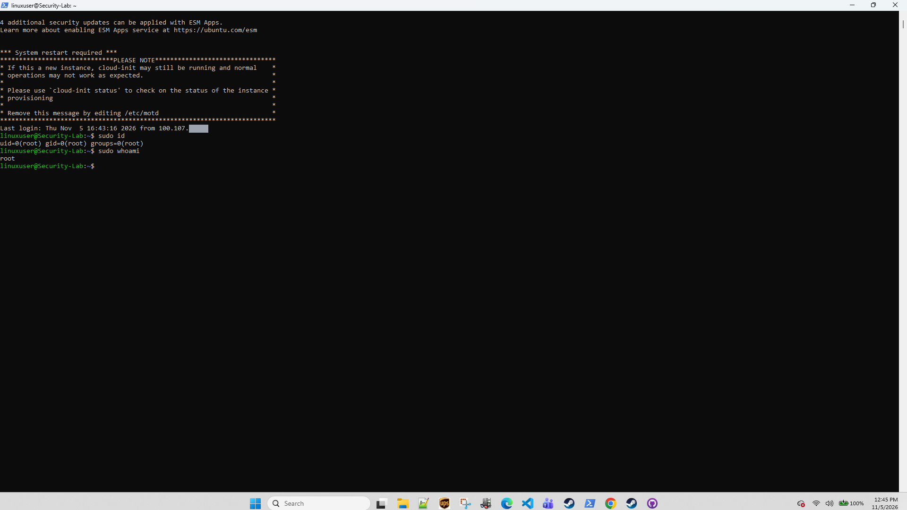
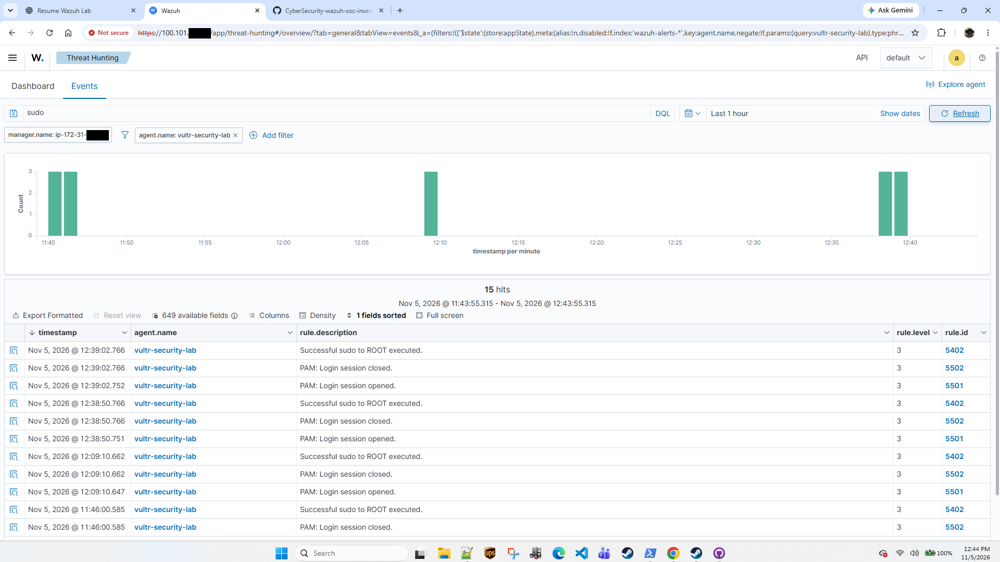
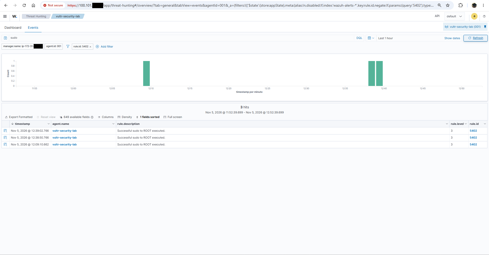
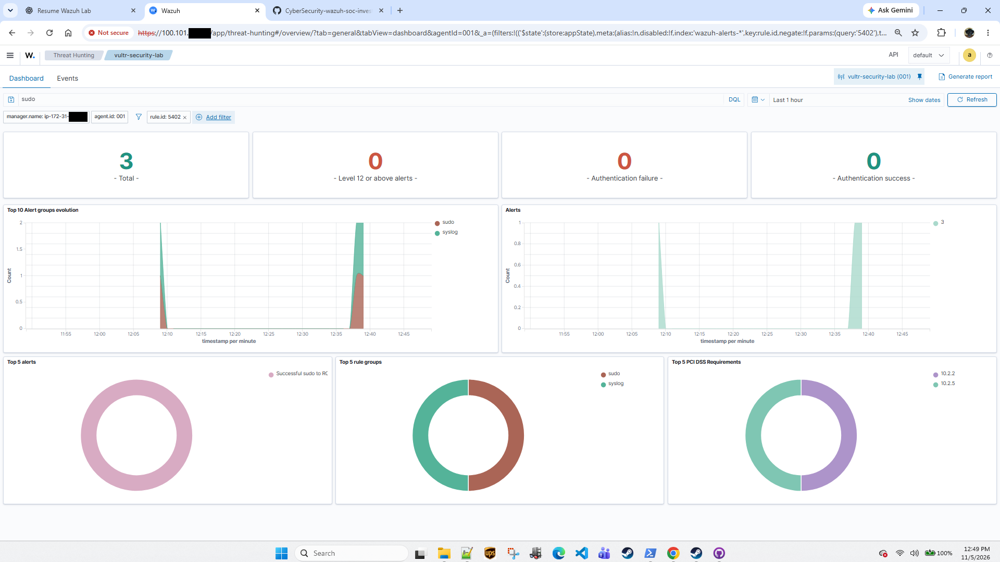

# Case 004: Controlled sudo Test — Tracing a Known Action into Wazuh

## Summary

| | |
|:---|:---|
| **Purpose** | Confirm end to end that a privileged command I run on the endpoint shows up in Wazuh with the expected rules, and practice proving that a privileged event was authorized. |
| **Asset** | `vultr-security-lab` (agent 001) |
| **Test** | In an SSH session from my admin workstation (over Tailscale) I ran `sudo id` and `sudo whoami`. |
| **Expected** | For each sudo: Rule 5501 *PAM: Login session opened* → Rule 5402 *Successful sudo to ROOT executed* → Rule 5502 *PAM: Login session closed*, all level 3. |
| **Result** | **Observed.** The pattern appears for every sudo in the window, and each of the five sudo-to-root alerts lines up with a command I ran and captured. |

---

## Evidence

### PRIV-01: The test commands (captured 12:45 EST)

  

**Observed:** a new SSH session (the banner shows the previous login, 16:43:16 UTC from my Tailscale address). `sudo id` → `uid=0(root) gid=0(root) groups=0(root)`; `sudo whoami` → `root`. The banner also shows `*** System restart required ***` and "4 additional security updates can be applied with ESM Apps".

**Why it matters:** this is the known, deliberate action used to test the detection path.

**What it does not prove:** when each command ran. The terminal has no timestamps, so matching to Wazuh is by order and timing.

### PRIV-02: Everything matching `sudo`, one hour

  

**Observed:** Events, free-text query `sudo`, filter `agent.name: vultr-security-lab`, last 1 hour (11:43:55–12:43:55 EST). 15 hits, which are five sets of 5501 → 5402 → 5502 at about 11:45:5x, 11:46:00, 12:09:10, 12:38:50 and 12:39:02. The 11:45 set is below the visible rows; the histogram bar shows it.

**Why it matters:** each sudo produces a predictable three-event pattern. To count sudo commands, count Rule 5402, not total hits.

**What it does not prove:** that a `sudo` text search catches every privileged action. `su`, `pkexec` or a direct root login would not match. The command names are in `data.command`, which is not expanded here.

### PRIV-03: Rule 5402 only

  

**Observed:** Events, `rule.id: 5402`, `agent.id: 001`, query `sudo`, last 1 hour (11:52:39–12:52:39 EST). Three hits: 12:09:10.662, 12:38:50.766, 12:39:02.766, level 3.

**Why it matters:** this isolates the sudo-to-root alerts. The 12:38:50 / 12:39:02 pair, 12 seconds apart, matches `sudo id` then `sudo whoami`.

**What it does not prove:** which command each alert is. Expanding the alerts to show `data.command` would settle it.

### PRIV-04: The same filter on the Dashboard tab

  

**Observed:** Total 3; Level 12 or above 0; Authentication failure 0; Authentication success 0. Top rule groups: `sudo`, `syslog`. PCI DSS tags 10.2.2 and 10.2.5.

**Why it matters:** a second example of dashboard scope (the first is EV-02 in Case 001). The authentication tiles are computed inside the `rule.id: 5402` filter, so they can only describe 5402 alerts, and 5402 is grouped as `sudo`/`syslog`, not as an authentication event. The PCI DSS tags are labels on the rule, not a compliance claim.

**What it does not prove:** anything about authentication activity on the host.

---

## Reconciliation: every sudo-to-root alert has an owner

| Wazuh 5402 (EST) | Command I ran | How it is matched |
|:---|:---|:---|
| ~11:45:52 *(below visible rows; histogram)* | `sudo tail -n 40 /var/log/auth.log` | **Direct:** the host log in AUTH-03 has the matching `COMMAND=/usr/bin/tail -n 40 /var/log/auth.log` line at 16:45:51 UTC |
| 11:46:00.585 | `sudo fail2ban-client status sshd` | Order: the next command in the AUTH-03 terminal |
| 12:09:10.662 | `sudo fail2ban-client status sshd` (second check) | Timing: AUTH-04 was captured at about 12:09 |
| 12:38:50.766 | `sudo id` | Order and timing: PRIV-01 |
| 12:39:02.766 | `sudo whoami` | Order and timing: PRIV-01 |

Two earlier sudo commands from the same session (16:43:33 and 16:43:41 UTC, `systemctl is-active …`) are in the host log too. They fall just before PRIV-02's window, which starts at 11:43:55 EST.

## What this proves, and what it doesn't

- **Proves:** sudo activity on the endpoint reaches Wazuh within seconds and is classified as 5501/5402/5502. All five sudo-to-root alerts in the window can be tied to commands I ran.
- **Does not prove:** the command-to-alert mapping is direct for one of the five; the other four are matched by order and timing. Capturing `data.command`, `data.srcuser` and `data.dstuser` from each 5402 alert would make all five direct.
- **About "authorized":** here I know the activity was authorized because I am the operator who ran it. In a real SOC, authorization comes from a change ticket or on-call record, not from the alert. Wazuh tags 5402 with ATT&CK T1548.003 (*Sudo and Sudo Caching*) on every successful sudo-to-root. The tag names a technique attackers use; it does not mean this sudo was abuse.

## Something else the test revealed

Neither session prompted for a sudo password. Both PRIV-01 and AUTH-03 start right after a fresh login, and the first `sudo` in each returns output with no `[sudo] password for linuxuser:` line. That is consistent with **passwordless sudo** for `linuxuser`, which cloud images often set up through cloud-init. If so, whoever holds the SSH key effectively holds root. To confirm: `sudo -l` (look for `NOPASSWD`) and `ls /etc/sudoers.d/`. Then decide whether that is acceptable for this lab.

## Next steps

1. Expand the 5402 alerts and capture `data.command` so all five matches are direct.
2. Test the failure path. A wrong sudo password should produce Wazuh's "Failed attempt to run sudo" rule (5401 in Wazuh's documented ruleset). This only works if passwordless sudo is turned off.
3. Confirm or remove passwordless sudo (`sudo -l`).
4. Decide whether a free-text `sudo` search is enough, or whether privileged activity should be tracked by rule group.

## What I took from this case

A detection is only worth trusting after you have watched it fire on something you did on purpose. This test also gave me a clean way to answer "how do you know this privileged event was authorized?": a matching command I ran, at a matching time, recorded on both sides.
